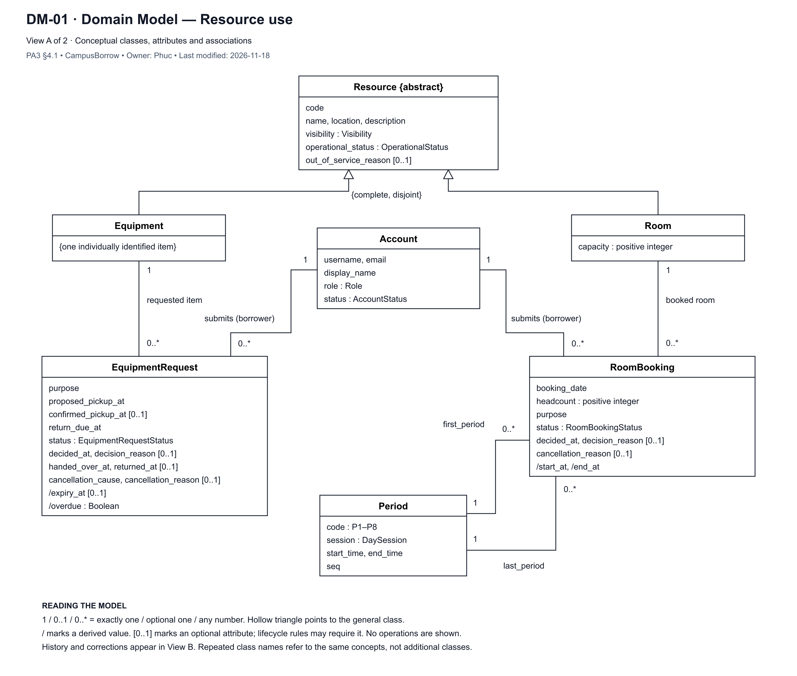
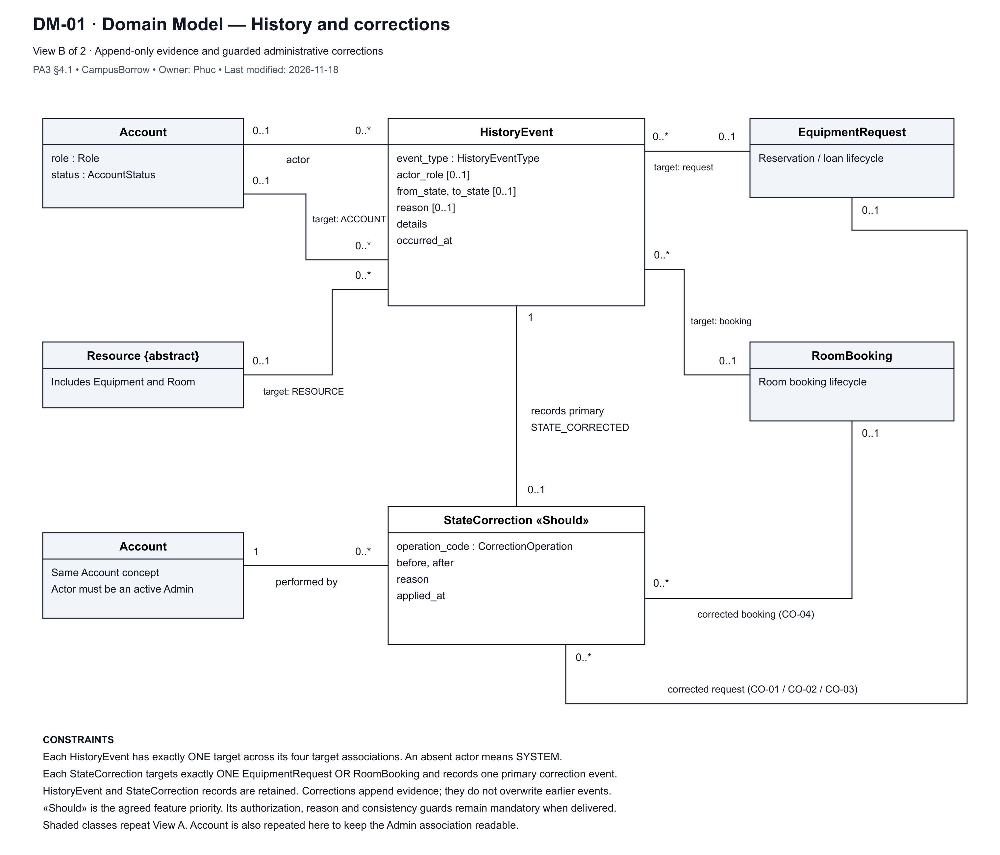

# DM-01 - CampusBorrow Domain Model

PA3 section 4.1 · Owner: Phuc · Prepared: 2026-11-18 · WBS area: 3.2 (Design data and objects).

Phuc reviewed and accepted the model in the working session. This repository copy is prepared for the team pull request; no additional team approval of this new deliverable is asserted.

One conceptual model is presented in two views: resource use, and history with administrative corrections.

## 1. Source baseline and scope

The model follows the PA2 SRS, the 13 Section 8 amendments confirmed as approved by the team, and the shared vocabulary in `PA3-Kickoff.md`. The approval confirmation supersedes the older amendment document's "Proposed" labels.

| Source              | Location / role                                                                                                                                       |
| ------------------- | ----------------------------------------------------------------------------------------------------------------------------------------------------- |
| PA2 SRS             | [T09-PA2.pdf](../../../pa/PA2/T09-PA2.pdf) - submitted requirements baseline.                                                                         |
| Kickoff             | `PA3-Kickoff.md`, supplied in the coursework root outside this repository - canonical class names, enums, period definitions and diagram conventions. |
| Approved amendments | `PA3-Team-Review/PA3_Section_8_Team_Review.html`, retained outside the repository - 13 amendments approved by the team, as confirmed by Phuc.         |
| PA3 template        | `T09-PA3-draft.docx.pdf`, supplied in the coursework root - Domain Model belongs in section 4.1.                                                      |

This is an analysis-level model: business concepts, selected descriptive attributes, associations, multiplicities and constraints. It contains no methods, services, controllers, repositories, framework components, foreign keys or database indexes. Domain objects have identity, but surrogate `id` fields and implementation bookkeeping are omitted. Technical ADRs being prepared by other members do not block this conceptual model.

## 2. DM-01 · View A — Resource use

**Important distinction:** the multiplicity `Equipment 1 — 0..* EquipmentRequest` includes historical and competing pending requests. It does not permit two effective reservations/loans for the same item. That temporal constraint is D04 below. Likewise, Room has many historical bookings, constrained by non-overlap of approved intervals.

## 3. DM-01 · View B — History and corrections

The target associations use an exclusive-choice constraint. The four optional HistoryEvent target links mean exactly one target overall, not four simultaneous targets or no target. A StateCorrection has the narrower request-or-booking target catalog. References repeated across views, including Account repeated within View B, refer to the same class.

## 4. Concept dictionary

| Concept          | Business meaning                                                         | Selected attributes                                                                         |
| ---------------- | ------------------------------------------------------------------------ | ------------------------------------------------------------------------------------------- |
| Account          | A registered identity with exactly one current role.                     | username, email, display_name, role, status                                                 |
| Resource         | Abstract common concept for a uniquely coded campus resource.            | code, name, location, description, visibility, operational_status, out_of_service_reason    |
| Equipment        | One individually identified physical item; specializes Resource.         | Inherited Resource attributes; no stock quantity                                            |
| Room             | A bookable room; specializes Resource.                                   | Inherited attributes and positive capacity                                                  |
| EquipmentRequest | The complete request, reservation and loan lifecycle for one item.       | Purpose, pickup times, return deadline, status, effective handover/return times and reasons |
| RoomBooking      | One borrower’s request for one room on one date.                         | Date, first/last Period associations, headcount, purpose, status and reasons                |
| Period           | A fixed teaching-period definition shared by all booking dates.          | code, session, start_time, end_time, seq                                                    |
| HistoryEvent     | An immutable record of a business action or system transition.           | event_type, actor_role, from_state, to_state, reason, details, occurred_at                  |
| StateCorrection  | A guarded administrative correction with retained before/after evidence. | operation_code, before, after, reason, applied_at; agreed priority: Should                  |

`/` marks a derived business value, independently of later persistence decisions. RoomBooking start/end may be stored in the implementation even though their values derive from the date and periods. Attribute `[0..1]` expresses lifecycle optionality; for example, a pending request has no decision reason, while a rejection requires one. The diagram lists selected conceptual attributes rather than a complete physical schema.

## 5. Associations and multiplicity

In the table, each multiplicity is written beside its own endpoint class, following UML endpoint notation.

| Association                         | Endpoint multiplicities                              | Meaning / constraint                                                                                                                                                               |
| ----------------------------------- | ---------------------------------------------------- | ---------------------------------------------------------------------------------------------------------------------------------------------------------------------------------- |
| Account — EquipmentRequest          | Account 1; EquipmentRequest 0..*                     | Each request has exactly one original borrower. An account may submit many requests.                                                                                               |
| Equipment — EquipmentRequest        | Equipment 1; EquipmentRequest 0..*                   | Each request concerns one item. The item may have many historical requests; active occupancy is constrained separately.                                                            |
| Account — RoomBooking               | Account 1; RoomBooking 0..*                          | Each booking has exactly one original borrower.                                                                                                                                    |
| Room — RoomBooking                  | Room 1; RoomBooking 0..*                             | Each booking concerns one room. Non-overlap constrains approved intervals, not the historical multiplicity.                                                                        |
| RoomBooking — Period (first_period) | RoomBooking 0..*; Period 1                           | Each booking has one first period; the same period definition may begin many bookings.                                                                                             |
| RoomBooking — Period (last_period)  | RoomBooking 0..*; Period 1                           | Each booking has one last period. First and last may be the same.                                                                                                                  |
| Account — HistoryEvent (actor)      | Account 0..1; HistoryEvent 0..*                      | Each event has at most one human actor; no Account actor denotes SYSTEM. An account can act in many events.                                                                        |
| HistoryEvent — target               | HistoryEvent 0..*; each target class 0..1            | Exactly one target overall: Account, Resource, EquipmentRequest or RoomBooking. The four optional associations are constrained by XOR. A resource target can be Equipment or Room. |
| Account — StateCorrection (admin)   | Account 1; StateCorrection 0..*                      | Each correction has one responsible Admin, who must be active at application time. Historical references survive later account changes.                                            |
| StateCorrection — target            | StateCorrection 0..*; each allowed target class 0..1 | Exactly one EquipmentRequest (CO-01–03) or RoomBooking (CO-04). Account and Resource are not correction targets in this catalog.                                                   |
| StateCorrection — HistoryEvent      | StateCorrection 0..1; HistoryEvent 1                 | Each correction has exactly one primary STATE_CORRECTED event. An ordinary event has no associated correction. A consequential expiry event is distinct from this primary event.   |
| Equipment / Room — Resource         | Generalization: complete and disjoint                | Every Resource is exactly one Equipment or one Room. These are conceptual types, not a requirement for separate database tables.                                                   |

## 6. Business constraints

D01–D13 below are local explanation labels for this model, not new SRS requirement identifiers.

| ID  | Concern                                     | Constraint                                                                                                                                                                                                                                                                                                                                                                                               | Source                                                                 |
| --- | ------------------------------------------- | -------------------------------------------------------------------------------------------------------------------------------------------------------------------------------------------------------------------------------------------------------------------------------------------------------------------------------------------------------------------------------------------------------- | ---------------------------------------------------------------------- |
| D01 | Identity and historical roles               | Account has one current Role. A requester must be a Borrower at submission; historical links are retained after role changes or deactivation. RM and Admin are not implicitly Borrowers. username and email are case-insensitively unique.                                                                                                                                                               | Kickoff Account / Role; PA2 BR-06                                      |
| D02 | Shared resource identity                    | Resource.code is unique across Equipment and Room; code and resource type are immutable. Each Equipment is one item. Room.capacity is positive. Resource deletion must not destroy historical references.                                                                                                                                                                                                | Kickoff Resource / Equipment / Room; PA2 BR-12 / FR-02-01              |
| D03 | Independent resource properties             | Visibility and operational status are independent of occupancy. A hidden or out-of-service resource can still have historical and outstanding usage. Maintenance is an out-of-service reason, not a separate enum state. New resources start HIDDEN and OUT_OF_SERVICE.                                                                                                                                  | Kickoff resource states; approved Section 8                            |
| D04 | Equipment occupancy                         | An item can have many pending and historical requests, but at most one effective APPROVED reservation or ON_LOAN request at any instant. Successful approval rejects competing PENDING requests for that item. Reject a duplicate active request by the same Borrower for that item.                                                                                                                     | PA2 equipment flow; kickoff; approved Section 8                        |
| D05 | Reservation and loan are lifecycle meanings | APPROVED means reservation; ON_LOAN means loan. Neither is a separate class. Cancellation/expiry cannot be used to erase an outstanding loan; release follows an effective recorded return.                                                                                                                                                                                                              | Kickoff EquipmentRequest; approved Section 8                           |
| D06 | Pickup, expiry and overdue                  | For an approved reservation, /expiry_at = min(confirmed_pickup_at + 24 hours, return_due_at). Handover requires confirmed_pickup_at ≤ now < expiry_at. At now ≥ expiry_at, normal expiry changes APPROVED to CANCELLED with SYSTEM_EXPIRY. /overdue is true only for ON_LOAN with now > return_due_at and no effective return. Neither EXPIRED nor OVERDUE is a stored lifecycle state.                  | Kickoff derived values; approved Section 8                             |
| D07 | Fixed room periods                          | The first and last Period must belong to the same morning or afternoon session, with first.seq ≤ last.seq. All intermediate periods are included. A booking may span 1–4 periods, including an internal break, but cannot span lunch. The same definitions apply every day.                                                                                                                              | Kickoff Period; PA2 BR-03                                              |
| D08 | Room intervals and capacity                 | Derive /start_at and /end_at from booking_date and boundary periods in UTC+7. The interval is [start_at, end_at). Start must be in the future when submitting; headcount is an integer from 1 to Room.capacity. Approved bookings for one room must not overlap. Approval rechecks conflicts; competing PENDING bookings remain pending. No COMPLETED state is introduced when an approved booking ends. | Kickoff RoomBooking; approved Section 8                                |
| D09 | Reasons and optional attributes             | A rejection reason is mandatory after trimming, length 1–500. Correction reasons are also mandatory, length 1–500. Room cancellation reason is optional; blank means absent. [0..1] means not present in every lifecycle state, not optional when a specific action requires it.                                                                                                                         | Lecturer feedback; approved Section 8                                  |
| D10 | History attribution and target              | Each event has exactly one business target. Human events retain the actor Account and role at event time; system events have no Account actor. Only human roles use Role; SYSTEM is not an extra Account role. Preserve original events and all required audit evidence; no synthetic overdue event is created merely because time passes.                                                               | Kickoff HistoryEvent / HistoryEventType; PA2 BR-19; approved Section 8 |
| D11 | Staff actions                               | All Resource Managers operate unit-wide; no manager-to-resource assignment is implied. RM/Admin may approve, reject, record handover and record return within their permissions. Only RM edits confirmed pickup. Action actors are represented via HistoryEvent; decided_by, handed_over_by and returned_by are direct references that the design class model may add for convenience.                   | Kickoff actors; PA2 workflows; approved Section 8                      |
| D12 | Correction catalog and evidence             | StateCorrection is a Should feature. If delivered, active-Admin authorization, a trimmed reason, before/after preview, confirmation, current-state checks, concurrency checks and atomic consistency are required. Append before/after evidence and one primary STATE_CORRECTED event; never rewrite original audit events.                                                                              | Approved Section 8 change 4; PA2 BR-20 / UC-22                         |
| D13 | Business time                               | Use authoritative server time; store instants as UTC and present campus time as UTC+7 in implementation. Half-open booking and pickup intervals do not change the strict now > return_due_at overdue rule.                                                                                                                                                                                               | Kickoff shared time convention; approved Section 8                     |

## 7. StateCorrection catalog

These are the four approved operations. A StateCorrection is a business record, while its associated HistoryEvent is the append-only audit entry. Their conceptual 1-to-1 primary-event relationship does not prescribe a new database column or table redesign.

| Operation                | Target           | Effective outcome                                                                    | Required guards                                                                                                                                                                                                                                                                                                |
| ------------------------ | ---------------- | ------------------------------------------------------------------------------------ | -------------------------------------------------------------------------------------------------------------------------------------------------------------------------------------------------------------------------------------------------------------------------------------------------------------- |
| CO_01_VOID_HANDOVER      | EquipmentRequest | ON_LOAN → APPROVED if unexpired; otherwise normal expiry → CANCELLED / SYSTEM_EXPIRY | Confirm the item never left the store, no effective return exists and no conflicting occupancy exists. Preserve pickup and return deadline; an expired reservation must not be revived. Retain the immediate expiry outcome and its audit evidence.                                                            |
| CO_02_VOID_RETURN        | EquipmentRequest | RETURNED → ON_LOAN                                                                   | Confirm the item remains with the borrower; no later reservation or loan may exist. Recheck occupancy. The account must still have BORROWER role; inactivity alone is not a blocker. Preserve deadline and derive overdue.                                                                                     |
| CO_03_FIX_EVENT_TIME     | EquipmentRequest | Lifecycle state unchanged                                                            | Correct only an existing effective handover/return time. Require approval ≤ handover ≤ now and, when return exists, handover ≤ return ≤ now. The corrected handover must obey its applicable historical pickup window. Do not create contradictory occupancy; preserve original evidence, pickup and deadline. |
| CO_04_VOID_ROOM_APPROVAL | RoomBooking      | APPROVED → CANCELLED                                                                 | Booking must not yet have started at confirmation and must still be approved. Release its interval once. This is correction of an erroneous approval, not a general staff cancellation facility.                                                                                                               |

## 8. Shared values

| Value type             | Allowed values                                                                                               |
| ---------------------- | ------------------------------------------------------------------------------------------------------------ |
| Role                   | BORROWER, RESOURCE_MANAGER, ADMIN                                                                            |
| AccountStatus          | ACTIVE, INACTIVE                                                                                             |
| Visibility             | VISIBLE, HIDDEN                                                                                              |
| OperationalStatus      | IN_SERVICE, OUT_OF_SERVICE                                                                                   |
| EquipmentRequestStatus | PENDING, APPROVED, REJECTED, CANCELLED, ON_LOAN, RETURNED                                                    |
| CancellationCause      | BORROWER, STAFF_OUT_OF_SERVICE, SYSTEM_EXPIRY                                                                |
| RoomBookingStatus      | PENDING, APPROVED, REJECTED, CANCELLED                                                                       |
| DaySession             | MORNING, AFTERNOON                                                                                           |
| ResourceType           | EQUIPMENT, ROOM — represented by the specialization in this model                                            |
| TargetType             | ACCOUNT, RESOURCE, EQUIPMENT_REQUEST, ROOM_BOOKING — HistoryEvent; correction targets are restricted further |
| CorrectionOperation    | CO_01_VOID_HANDOVER, CO_02_VOID_RETURN, CO_03_FIX_EVENT_TIME, CO_04_VOID_ROOM_APPROVAL                       |

### HistoryEventType

`ACCOUNT_REGISTERED, ACCOUNT_CREATED, ACCOUNT_DEACTIVATED, ACCOUNT_REACTIVATED, ROLE_CHANGED, PASSWORD_RESET, RESOURCE_CREATED, RESOURCE_UPDATED, VISIBILITY_CHANGED, OPERATIONAL_STATUS_CHANGED, EQ_REQUEST_SUBMITTED, EQ_REQUEST_APPROVED, EQ_REQUEST_REJECTED, EQ_REQUEST_AUTO_REJECTED, PICKUP_CHANGED, EQ_REQUEST_CANCELLED, EQ_REQUEST_EXPIRED, HANDOVER_RECORDED, RETURN_RECORDED, BOOKING_SUBMITTED, BOOKING_APPROVED, BOOKING_REJECTED, BOOKING_CANCELLED, STATE_CORRECTED`

No separate overdue event is introduced. Actor role is a historical snapshot for a human action; absence of an Account actor represents a system action.

### Fixed Period definitions (campus time, UTC+7)

| Code | Session   | Start | End   |
| ---- | --------- | ----- | ----- |
| P1   | MORNING   | 07:30 | 08:15 |
| P2   | MORNING   | 08:15 | 09:00 |
| P3   | MORNING   | 09:30 | 10:15 |
| P4   | MORNING   | 10:15 | 11:00 |
| P5   | AFTERNOON | 13:30 | 14:15 |
| P6   | AFTERNOON | 14:15 | 15:00 |
| P7   | AFTERNOON | 15:30 | 16:15 |
| P8   | AFTERNOON | 16:15 | 17:00 |

## 9. Boundaries for the Class Diagram and ERD authors

- Preserve the nine agreed class names. Resource has complete/disjoint Equipment and Room specializations; the agreed shared `resources` table is a separate persistence decision.
- Do not create Reservation, Loan, ExpiredRequest, OverdueLoan or CompletedBooking entities/states from display terms. Keep Borrower, Resource Manager and Admin as Account role values.
- Credential hashes, token_version, optimistic-lock version, RevokedToken, JWT behavior and background jobs belong to the design model. They are deliberately absent here.
- Do not add F10/F11 entities for the Could-level reporting/export and pickup-change proposal ideas. The approved core vocabulary has no such separate domain objects.
- HistoryEvent actor/target associations express business attribution. The design model may show direct decision/handover/return staff references from the kickoff; these do not create extra domain classes.
- Use ordinary associations, not deletion-cascading composition, for accounts, resources, requests and audit records. Retain evidence through deactivation, status changes and corrections.

## 10. Review and handoff

- Review class names and meanings against kickoff, then verify every endpoint multiplicity using §5.
- Confirm that the state-machine and sequence-diagram authors preserve D04–D08 and the four correction guards.
- Check consistency of the Class Diagram and ERD with the agreed target restrictions and historical role snapshots.
- Place both views under PA3 §4.1 with captions “DM-01 (A): Resource use” and “DM-01 (B): History and corrections”; include the business constraints beside them or refer to their supporting table.

**Ready-to-use report paragraph:** The CampusBorrow domain model contains Account, the abstract Resource and its Equipment/Room specializations, EquipmentRequest, RoomBooking, Period, HistoryEvent and StateCorrection. Each request or booking belongs to one borrower and concerns one resource of the appropriate type. Equipment reservation and loan are lifecycle states of EquipmentRequest. RoomBooking derives its interval from a booking date and two boundary Periods. HistoryEvent preserves action attribution and one business target, while the Should-priority StateCorrection records only the four approved administrative correction operations. Temporal exclusivity, room non-overlap and correction guards constrain the associations without changing their historical multiplicities.

## 11. Files and editing

| File                                                                             | Purpose                                                          |
| -------------------------------------------------------------------------------- | ---------------------------------------------------------------- |
| [DM-01_domain-model.drawio](DM-01_domain-model.drawio)                           | Editable master with two pages.                                  |
| [DM-01-A_resource-use.drawio.png](DM-01-A_resource-use.drawio.png)               | View A at 200%, with its single-page draw.io XML embedded.       |
| [DM-01-B_history-corrections.drawio.png](DM-01-B_history-corrections.drawio.png) | View B at 200%, with its single-page draw.io XML embedded.       |
| [DM-01-A_resource-use.svg](DM-01-A_resource-use.svg)                             | Vector preview of View A.                                        |
| [DM-01-B_history-corrections.svg](DM-01-B_history-corrections.svg)               | Vector preview of View B.                                        |
| [README.md](README.md)                                                           | Concept dictionary, associations, constraints and handoff notes. |

Edit the master in draw.io and re-export the affected views to keep the images synchronized. PNG generation uses a 10-unit white diagram border, scaled with the diagram at 200%.

The original review HTML, generation script and layout JSON remain in `PA3-Team-Review/Domain-Model/` outside the repository. They are not required to open or edit the draw.io master. This folder follows the allowed document extensions in `scripts/check-docs.mjs`.

Validation performed: draw.io XML structure and references; the nine agreed domain concepts; PNG integrity and embedded XML matching the corresponding master page; visual inspection of both rendered views. No interactive draw.io editor session is claimed.
