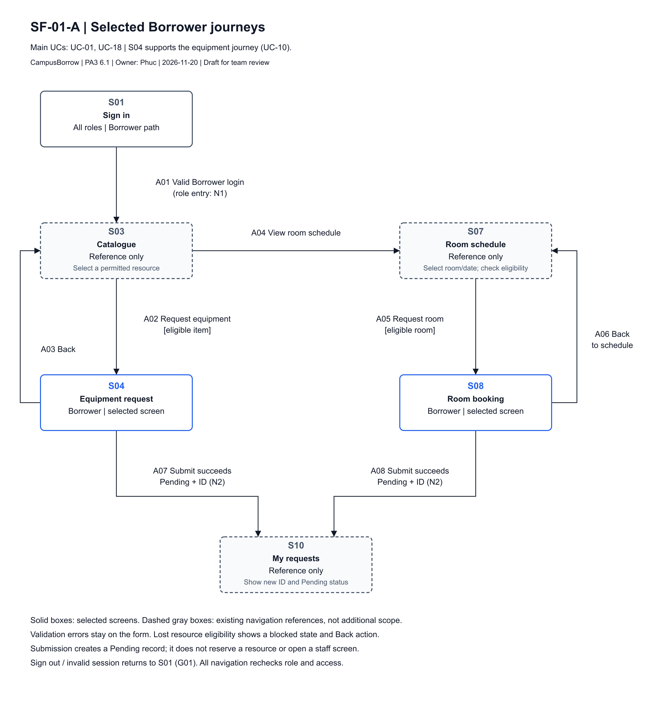
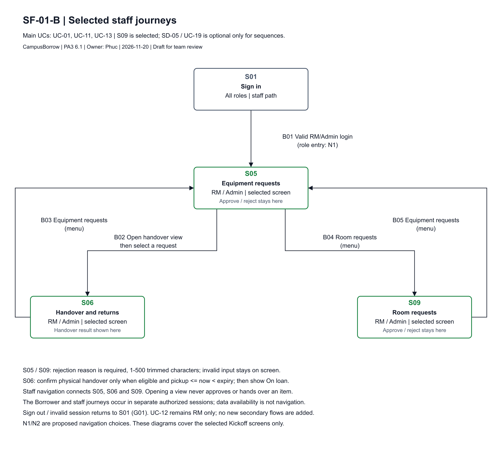

# CampusBorrow — PA3 section 6.1 Screen List and Screen Flow

Owner: Phuc · Diagram: SF-01 · WBS: 3.3.1 · Revision: 2, focused Kickoff scope · Prepared: 2026-11-20.

Phuc reviewed this revision and requested its inclusion in the repository. This copy is prepared for team review through a pull request; no additional team approval is asserted.

The deliverable covers the four main use cases and six screens selected at Kickoff, using PA2 v2 mockups as references. It supplies the navigation baseline for **T18 Screen Specs** and **T19 Accessibility**.

[SF-01_screen-flow.drawio](SF-01_screen-flow.drawio) is the editable two-page master. Both views are included below as PNGs with embedded editable source; SVGs provide vector previews.

## 1. Selected scope and sources

| Main use case chosen at Kickoff              | Actor               | Primary screen | Sequence alignment |
| -------------------------------------------- | ------------------- | -------------- | ------------------ |
| UC-01 Sign in                                | Borrower, RM, Admin | S01            | SD-01              |
| UC-11 Approve or reject an equipment request | RM, Admin           | S05            | SD-02              |
| UC-13 Record equipment handover              | RM, Admin           | S06            | SD-03              |
| UC-18 Submit a room booking request          | Borrower            | S08            | SD-04              |

The **six selected screens are S01, S04, S05, S06, S08 and S09**. S04 is retained because Kickoff explicitly selects the equipment-submission screen (UC-10). S09 is also retained because it is one of the six selected screens and addresses the lecturer's rejection-reason feedback. **UC-19 is optional only as the fifth sequence diagram; S09 is not optional in this screen deliverable.** Existing secondary use cases on S01/S05/S06 remain mapped for traceability, without expanding this task into separate workflows for every use case.

| Source                                                                               | Use                                                                                                                                                           |
| ------------------------------------------------------------------------------------ | ------------------------------------------------------------------------------------------------------------------------------------------------------------- |
| `PA3-Kickoff.md` (coursework root, outside the repository)                           | Four main UCs, six selected screens, canonical IDs/names, actors, validations and drawing conventions.                                                        |
| `T09-PA2-v2.docx.pdf` (downloaded v2 in the coursework root, outside the repository) | UC behavior and exported mockups: S01 p. 109; S04 p. 113; S05/S06 p. 114; S08 p. 117; S09 p. 118. Numbers are PDF viewer pages. Frame links are listed in §6. |
| `PA3-Team-Review/PA3_Section_8_Team_Review.html` (outside the repository)            | Agreed amendments, already approved by the team; required rejection reasons and shared time/consistency rules apply.                                          |
| User's task brief                                                                    | Focus on Kickoff's selected UCs/screens; preserve shared screen IDs; hand off to T18 and T19.                                                                 |

PA3 content is in English, as agreed at Kickoff. Names follow the shared glossary: **Equipment requests** for S05 and **Handover and returns** for S06, even where older PA2 captions differ.

## 2. Screen list — six selected screens

RM means Resource Manager. RM and Admin may perform the listed staff actions, but they do not inherit Borrower submission permissions. S01 is the unauthenticated entry for all account roles.

| #   | Screen               | Description                                                                                                                                                                                                                                      | Related use case                                                | Actor               |
| --- | -------------------- | ------------------------------------------------------------------------------------------------------------------------------------------------------------------------------------------------------------------------------------------------ | --------------------------------------------------------------- | ------------------- |
| S01 | Sign in              | Authenticate an active account by username/email and password, then enter the permitted role view. Keep failed attempts on S01 with a generic error. Sign out or an invalid session returns here.                                                | **UC-01 (main)**; UC-02 as shared sign-out behavior             | Borrower, RM, Admin |
| S04 | Equipment request    | Request one eligible equipment item with purpose, proposed pickup and return deadline. On successful submission, show the new request ID and Pending status. No reservation exists until staff approval.                                         | UC-10 — selected supporting screen                              | Borrower            |
| S05 | Equipment requests   | Review Pending equipment requests and approve/reserve or reject with a mandatory reason. Keep the decision result within S05. A confirmed-pickup edit remains available only to RM.                                                              | **UC-11 (main)**; UC-12 as existing RM-only functionality       | RM, Admin           |
| S06 | Handover and returns | Open approved reservations and record eligible physical handover. Keep confirmation and the resulting On loan state within S06. The same existing screen also contains return and overdue views.                                                 | **UC-13 (main)**; UC-14, UC-16 as existing screen functionality | RM, Admin           |
| S08 | Room booking         | Request one room/date using consecutive configured periods in one session, purpose and headcount. Show the derived interval; validate eligibility, future start, capacity and approved overlap. Successful submission creates a Pending request. | **UC-18 (main)**                                                | Borrower            |
| S09 | Room requests        | Review Pending room requests, approve an eligible interval or reject with a mandatory reason. Keep the decision result within S09 and recheck overlap at approval.                                                                               | UC-19 — selected screen; optional SD-05                         | RM, Admin           |

The diagrams use **S03 Catalogue, S07 Room schedule and S10 My requests only as navigation references**. They are gray, dashed boxes marked “Reference only,” not additional entries in the selected Screen List. They prevent misleading arrows that would open a request form without selecting a resource or send a Borrower into a staff queue. Their own workflows are not expanded here.

## 3. SF-01 screen flow

Boxes with solid borders represent selected screens; gray dashed boxes represent existing screens used only for entry/exit context. Solid arrows mean navigation by the same signed-in user. The two views belong to the same SF-01. Repeated S01/S05 IDs refer to the same screens.

### SF-01-A — Borrower request journeys

After sign-in, a Borrower selects equipment through S03 or a room/date through S07. S04 and S08 return to their originating context when Back is selected. On successful submission, the proposed destination is S10 with the new request ID and Pending status visible. A validation error stays on the originating form. A resource that is no longer requestable produces a blocked/error state and an appropriate Back action rather than a successful request.

### SF-01-B — Staff processing and handover

RM/Admin enter the operational workspace and use its navigation to open S05, S06 or S09. Approve/reject and handover are actions within their screens; opening S06 does not itself record handover. The server rechecks the selected request and time window when staff confirm the action.

**Borrower submission does not navigate to S05 or S09.** It makes a Pending record available in the staff queue, which another authorized session opens separately. Likewise, equipment approval does not move a Borrower's browser into the handover screen. Both submission and staff processing are shown without treating a business-state change as cross-role navigation.

### Navigation decisions for this review

The SRS defines permitted behavior but does not prescribe every landing/return destination. The following two choices are proposed PA3 navigation decisions:

| Decision | Choice                                                                                                                                                                                                                                      |
| -------- | ------------------------------------------------------------------------------------------------------------------------------------------------------------------------------------------------------------------------------------------- |
| N1       | For these selected journeys, sign-in opens S03 for Borrower and S05 for RM/Admin. Staff can switch between S05, S06 and S09 through the operational menu. This does not alter their permissions.                                            |
| N2       | Successful S04/S08 submission opens S10 and identifies the new Pending request. Back opens S03/S07 respectively without submission. Validation errors retain the form and entered non-secret values where the resource remains requestable. |

Other existing navigation, such as S01's Create Borrower account link, remains outside this focused flow; omitting it does not remove the product feature. S08m is the existing mobile variant used as an accessibility/responsive reference, not a seventh selected screen.

## 4. Navigation and in-screen outcomes

| Edge | From → To                         | Event / condition                                             | Outcome                                                                                                                                               |
| ---- | --------------------------------- | ------------------------------------------------------------- | ----------------------------------------------------------------------------------------------------------------------------------------------------- |
| A01  | S01 → S03 (reference)             | Successful active Borrower sign-in                            | Open permitted catalogue context; N1.                                                                                                                 |
| A02  | S03 (reference) → S04             | Select Request equipment for an eligible item                 | Carry item identity; submission rechecks eligibility and duplicate active requests.                                                                   |
| A03  | S04 → S03 (reference)             | Back to catalogue                                             | Leave the request form without creating a request.                                                                                                    |
| A04  | S03 (reference) → S07 (reference) | Open a permitted room's schedule                              | Carry room identity and select a date.                                                                                                                |
| A05  | S07 (reference) → S08             | Borrower chooses Request room; room is Visible and In service | Carry room/date/period context where selected. Out-of-service state disables this entry.                                                              |
| A06  | S08 → S07 (reference)             | Back to schedule                                              | Return to the selected room/date without submission.                                                                                                  |
| A07  | S04 → S10 (reference)             | Equipment request saved successfully                          | Show new ID and Pending status; no reservation yet; N2.                                                                                               |
| A08  | S08 → S10 (reference)             | Room request saved successfully                               | Show new ID and Pending status; no reserved interval yet; N2.                                                                                         |
| B01  | S01 → S05                         | Successful active RM/Admin sign-in                            | Open operational entry; N1.                                                                                                                           |
| B02  | S05 → S06                         | Select Handover and returns                                   | Open the current reservation/loan view; select an eligible approved request before handover.                                                          |
| B03  | S06 → S05                         | Select Equipment requests in navigation                       | Return to the equipment processing view.                                                                                                              |
| B04  | S05 → S09                         | Select Room requests in navigation                            | Open the room processing queue.                                                                                                                       |
| B05  | S09 → S05                         | Select Equipment requests in navigation                       | Return to the equipment processing view.                                                                                                              |
| G01  | Any authenticated screen → S01    | Sign out or session invalid/expired/revoked                   | End/clear the current session as applicable and require sign-in. If server revocation cannot be confirmed, report failure; do not claim it succeeded. |

The same staff menu makes S05/S06/S09 reachable from each of those screens; only representative menu arrows are drawn. No automatic save occurs when switching sections. Direct links still require server-side role and record checks. A generic forbidden response must not reveal another Borrower's private data.

| Screen | In-screen action or failure             | Behavior to preserve for T18                                                                                                                                                                                                                                                  |
| ------ | --------------------------------------- | ----------------------------------------------------------------------------------------------------------------------------------------------------------------------------------------------------------------------------------------------------------------------------- |
| S01    | Invalid credentials or Inactive account | Stay on S01, show a generic error, issue no session. Trim the identifier; do not trim the password.                                                                                                                                                                           |
| S04    | Invalid input or lost item eligibility  | Purpose required; proposed pickup > now and < return deadline. Keep correctable input errors on the form. If the item becomes unrequestable, show the blocked state and Back to catalogue; create no request.                                                                 |
| S05    | Approve / Reject                        | Recheck Pending state and eligibility. Approval reserves the item and consistently auto-rejects competing Pending requests. Rejection requires 1–500 characters after trimming; invalid reason shows an inline field error. Refresh S05 after success.                        |
| S06    | Record handover                         | Require current approved eligibility and confirmed pickup ≤ now < expiry. Confirm physical handover, then display On loan on S06. Too early, expired or concurrently changed requests must not produce handover. Server checks still apply if the UI is stale.                |
| S08    | Submit / validation failure             | First/last periods must be consecutive within one session; derived start must be future. Require purpose and integer headcount from 1 to capacity; reject approved overlap. Retain entered values on correctable errors.                                                      |
| S09    | Approve / Reject                        | Recheck current state, future start, capacity and approved overlap. Rejection requires a trimmed reason of 1–500 characters. Approval conflict leaves the request Pending unless another valid action has already changed it. Do not auto-reject other Pending room requests. |

Use server time and display UTC+7. Error, blocked, confirmation, empty-list and success states remain within their screen, not new screen IDs. Secondary UC-12/14/16 controls keep their Kickoff permissions; they do not become extra main flow diagrams in this task.

## 5. Handoff to T18 Screen Specs and T19 Accessibility

T18 should specify the controls/events/validation for these **same six screens**, using this list and flow as its boundary. T19 should record checks and evidence against the resulting current mockups/prototype. The table below identifies work to perform; it is not a completed accessibility audit.

| Screen | T18 focus                                                                                                                               | T19 checks to perform                                                                                                                                                           |
| ------ | --------------------------------------------------------------------------------------------------------------------------------------- | ------------------------------------------------------------------------------------------------------------------------------------------------------------------------------- |
| S01    | Identifier/password inputs, submit, generic failure, role entry, session return.                                                        | Persistent labels, meaningful input names, keyboard submission, visible focus and perceivable generic error.                                                                    |
| S04    | Selected item, purpose, pickup/return fields, Submit, Back, success destination, blocked item and field errors.                         | Logical Tab order, labels including date/time meaning, keyboard-operable inputs, field-linked errors and text explanation of blocked actions.                                   |
| S05    | Queue selection, approve/reject controls, confirmed pickup, required reason, decision result/conflict; UC-12 control restricted to RM.  | Keyboard-operable queue/review controls, required reason conveyed in text, perceivable errors, confirmation focus handling and status feedback without color alone.             |
| S06    | Approved-request selection, handover eligibility/confirmation/result; retain existing return/overdue controls and permissions.          | Explain disabled handover in text; keyboard operation and confirmation focus; distinguish Approved, On loan and Overdue without color alone.                                    |
| S08    | Room/date, first/last period, read-only interval, headcount, purpose, Submit/Back, overlap/capacity/session errors and input retention. | Check form labels and Tab order, keyboard period selection, field-specific errors, readable derived times and responsive layout; compare S08m as the existing mobile reference. |
| S09    | Pending-booking review, approve/reject, mandatory reason, conflict/current-state result and corrected period labels.                    | Same rejection/error/focus checks as S05; readable booking details and status labels; keyboard access to decisions.                                                             |

Across all six screens, T19 must measure text contrast against NFR-11's ≥ 4.5:1 criterion, check visible focus, logical focus order, labels and errors, non-color status cues and responsive layout. Keyboard behavior and focus restoration require an interactive implementation/prototype; static PDF screenshots alone cannot establish a pass. Record the tested version, observation/measurement and outcome.

## 6. PA2 mockup references and corrections

These six links are copied from the downloaded PA2 v2, not newly created frames. The exported PDF images were inspected. Live Figma access remains unverified; the earlier connection lacked access to the desktop file.

<!-- FRAME_TABLE_START -->

| Screen | PA2 v2 PDF page | Reference                                                                                                                                                                                                    |
| ------ | --------------- | ------------------------------------------------------------------------------------------------------------------------------------------------------------------------------------------------------------ |
| S01    | 109             | [PA2 frame](https://www.figma.com/proto/xgOD9kWskBM4XbTyX26HGc/CampusBorrow-T09-SRS-PA2-wireframes?node-id=187-3&p=f&scaling=min-zoom&content-scaling=fixed&page-id=187%3A2&starting-point-node-id=187%3A3)  |
| S04    | 113             | [PA2 frame](https://www.figma.com/proto/xgOD9kWskBM4XbTyX26HGc/CampusBorrow-T09-SRS-PA2-wireframes?node-id=187-9&p=f&scaling=min-zoom&content-scaling=fixed&page-id=187%3A2&starting-point-node-id=187%3A3)  |
| S05    | 114             | [PA2 frame](https://www.figma.com/proto/xgOD9kWskBM4XbTyX26HGc/CampusBorrow-T09-SRS-PA2-wireframes?node-id=187-11&p=f&scaling=min-zoom&content-scaling=fixed&page-id=187%3A2&starting-point-node-id=187%3A3) |
| S06    | 114             | [PA2 frame](https://www.figma.com/proto/xgOD9kWskBM4XbTyX26HGc/CampusBorrow-T09-SRS-PA2-wireframes?node-id=187-13&p=f&scaling=min-zoom&content-scaling=fixed&page-id=187%3A2&starting-point-node-id=187%3A3) |
| S08    | 117             | [PA2 frame](https://www.figma.com/proto/xgOD9kWskBM4XbTyX26HGc/CampusBorrow-T09-SRS-PA2-wireframes?node-id=187-19&p=f&scaling=min-zoom&content-scaling=fixed&page-id=187%3A2&starting-point-node-id=187%3A3) |
| S09    | 118             | [PA2 frame](https://www.figma.com/proto/xgOD9kWskBM4XbTyX26HGc/CampusBorrow-T09-SRS-PA2-wireframes?node-id=187-21&p=f&scaling=min-zoom&content-scaling=fixed&page-id=187%3A2&starting-point-node-id=187%3A3) |

<!-- FRAME_TABLE_END -->

| Screen | Relevant observation in PA2 v2                                                                                               | Required handling                                                                                                                |
| ------ | ---------------------------------------------------------------------------------------------------------------------------- | -------------------------------------------------------------------------------------------------------------------------------- |
| S01    | p. 109 includes Sign in and a generic failed-sign-in state.                                                                  | Use the current credential/error concept; registration navigation is outside this selected task.                                 |
| S04    | p. 113 includes the request form, Back to catalogue and an item-no-longer-available state.                                   | Retain both form validation and blocked-resource behavior; no request when submission fails.                                     |
| S05    | p. 114 still labels Rejection reason Optional.                                                                               | Replace with Required, 1–500 trimmed characters, and add field-specific invalid/missing-reason feedback.                         |
| S06    | p. 114 includes handover, return and overdue areas.                                                                          | Keep the canonical name Handover and returns; handover is the main selected journey. Do not treat return/overdue as new screens. |
| S08    | p. 117 includes the form, Back to schedule and example errors for overlap, capacity, break-only and cross-session selection. | Preserve this coverage and correct period definitions; each example is an alternative state, not simultaneous results.           |
| S09    | p. 118 still labels rejection reason optional and shows the wrong P4 time in a sample row.                                   | Require the rejection reason and use P4 = 10:15–11:00, as defined at Kickoff and in S08's timetable.                             |

S12 and other full-system mockup gaps are outside this revised task's dependency list. They do not block this six-screen handoff. Exact post-login and post-submit destinations N1/N2 remain design choices for review, not verified Figma hotspots.

## 7. Review, validation and files

Review the six canonical screen names, four main UCs, navigation choices N1/N2 and the S05/S09 corrections. The Screen List and both SF-01 views form the focused section 6.1 deliverable. Section 5 hands off the relevant work to T18/T19 without claiming their tasks are complete.

| File                                                       | Purpose                                                              |
| ---------------------------------------------------------- | -------------------------------------------------------------------- |
| [README.md](README.md)                                     | Screen list, navigation rules, mockup references and handoff notes.  |
| [SF-01_screen-flow.drawio](SF-01_screen-flow.drawio)       | Editable master with Borrower and staff views.                       |
| [SF-01-A_borrower.drawio.png](SF-01-A_borrower.drawio.png) | Borrower view at 200%, with its single-page draw.io source embedded. |
| [SF-01-B_staff.drawio.png](SF-01-B_staff.drawio.png)       | Staff view at 200%, with its single-page draw.io source embedded.    |
| [SF-01-A_borrower.svg](SF-01-A_borrower.svg)               | Vector preview of the Borrower view.                                 |
| [SF-01-B_staff.svg](SF-01-B_staff.svg)                     | Vector preview of the staff view.                                    |

Edit the master in draw.io and re-export the affected views to keep them synchronized. The diagrams use Arial, a white background and the actor colors from Kickoff, with explicit role labels. Reference boxes are marked in text as well as by dashed gray borders. PNGs use a 10-unit white border scaled with the diagram at 200%.

The review HTML, generator, generated layout JSON and superseded broad draft remain in `PA3-Team-Review/Screen-Flow/` outside the repository. They are not required to open or edit the committed-format diagram files. This folder contains only document extensions allowed by `scripts/check-docs.mjs`.

Validation performed: the selected screen/use-case mappings; all diagram edge IDs against the navigation table; XML structure and references; PNG integrity, scale and embedded source matching the master; six Figma URLs against the downloaded PA2 v2; local document links; visual inspection of both exports. No live Figma verification or interactive draw.io editor session is claimed.
