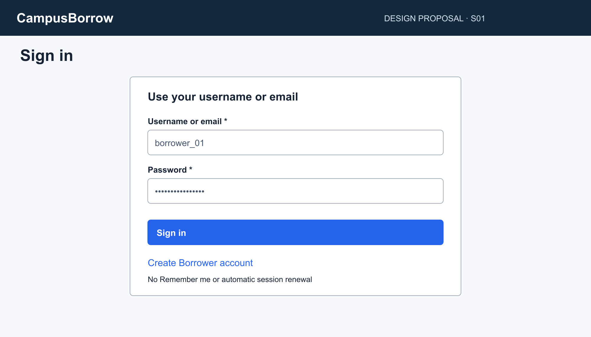
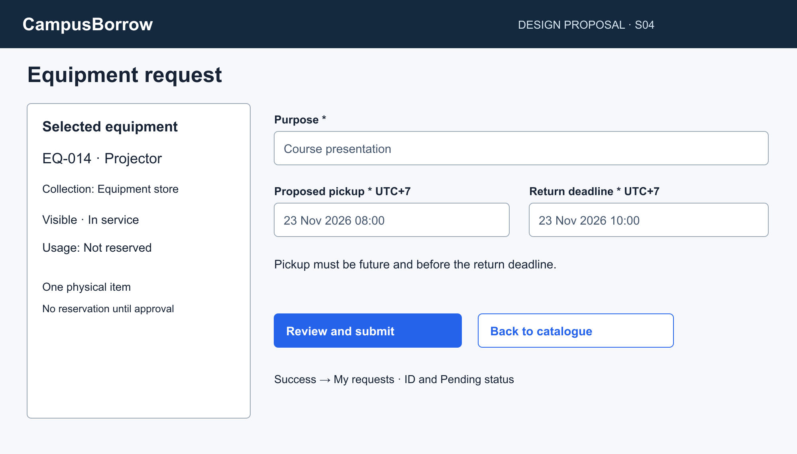
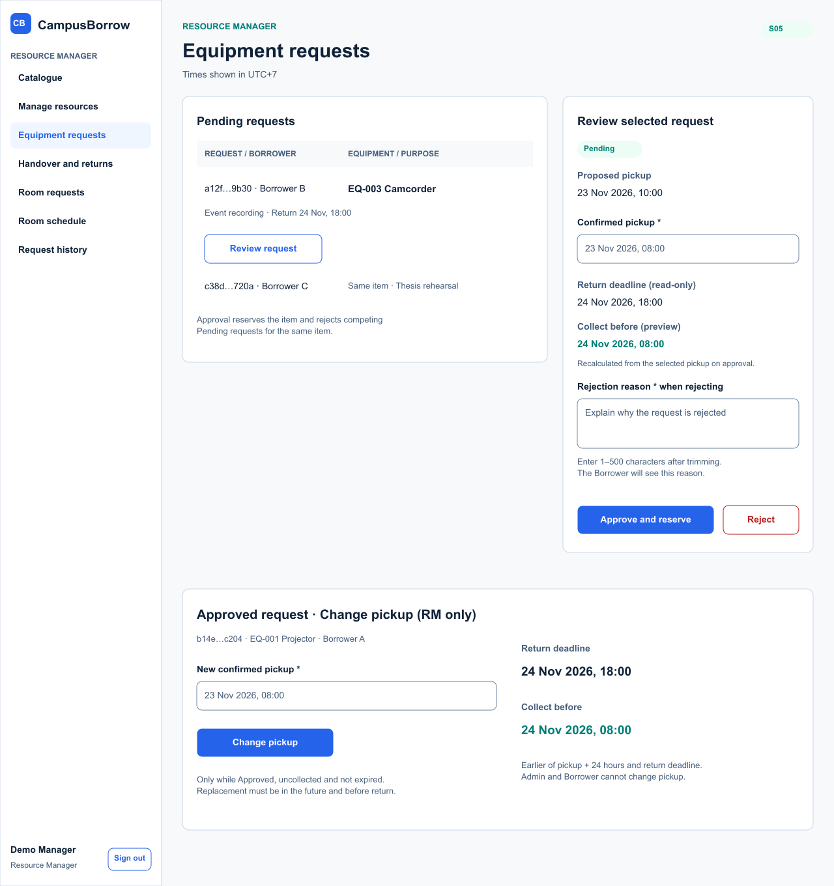
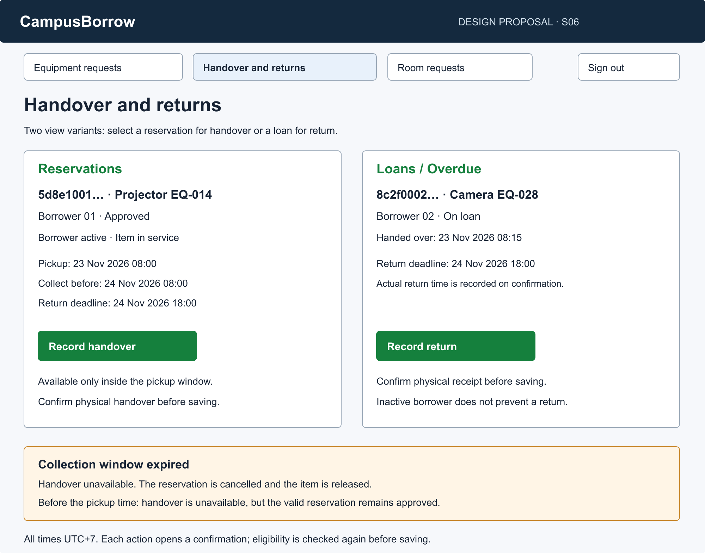
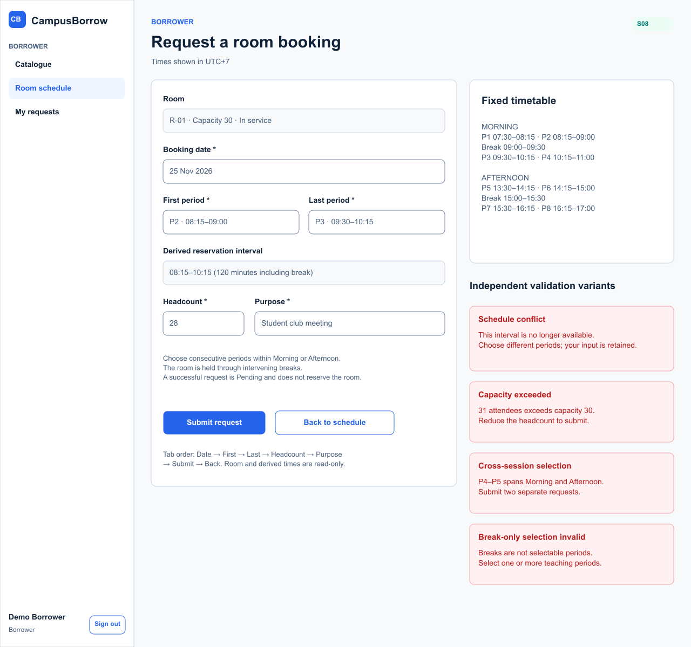
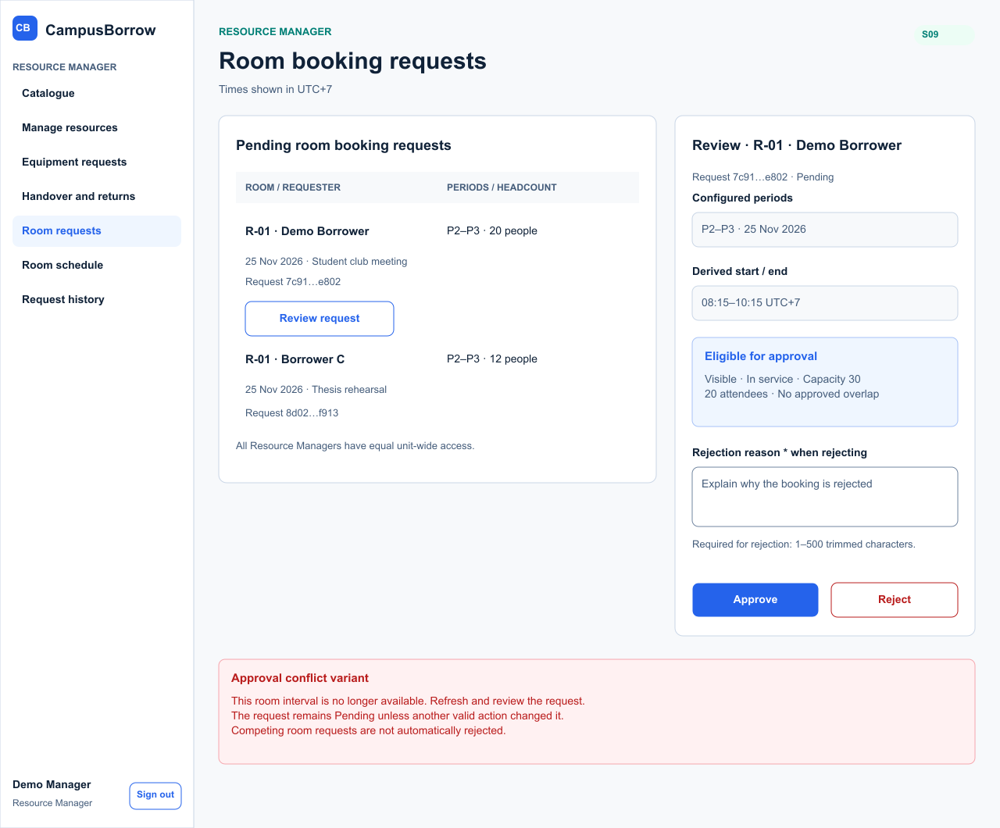

T18 · PA3 section 6.2 · WBS 3.3.2 and 3.3.3 · Draft for team review

# CampusBorrow Screen Specifications

This contribution specifies the six screens selected at Kickoff: S01, S04, S05, S06, S08 and S09. Each screen has an authored design image, controls, events, validation, failure behavior and data references. It can be merged into PA3 section 6.2 after team review.

The six images below are rendered from the same source as the Penpot design. They are reference renders, not live Penpot screenshots. Team approval and accessibility verification are pending.

## PA3 design and prototype handoff

Current design: [CampusBorrow PA3 in Penpot](https://design.penpot.app/?screen=workspace&team-id=cf924903-cff3-81f4-8008-fbc796ea80eb&file-id=cf924903-cff3-81f4-8008-fbc7ae1bf610&page-id=cf924903-cff3-81f4-8008-fbc7ae1bf611). Open Present/Play and select **T18 · Prototype review**. Choose Borrower, Manager or Admin to review the fixed sample journeys, confirmations, outcomes and errors. See the [Penpot handoff and review checklist](../penpot-t18/README.md) for the walkthrough and reproducible source.

The six selected screens retain 45 control IDs and use native editable text/shape layers. Additional boards represent role variants, dialogs, sample states and navigation context; they do not expand the six-screen specification scope. The prototype does not accept free typing or authenticate users, execute transactions, persist data or verify keyboard behavior. Main-screen navigation restores sample fixtures. The specification below remains the required application behavior; the prototype illustrates selected paths. Figma links are historical visual references.

The previous Figma target was [CampusBorrow PA3 - Desktop v5 UI](https://www.figma.com/design/XbN2utAC28sDab8KFPZXzc/CampusBorrow-T09-PA3?node-id=187-2). Keep the [original PA2 file](https://www.figma.com/design/xgOD9kWskBM4XbTyX26HGc/CampusBorrow-T09-SRS-PA2-wireframes) as the historical baseline; continue the editable prototype in Penpot.

| Screen                   | Historical PA3 Figma reference                                                                    |
| ------------------------ | ------------------------------------------------------------------------------------------------- |
| S01 Sign in              | [187:3](https://www.figma.com/design/XbN2utAC28sDab8KFPZXzc/CampusBorrow-T09-PA3?node-id=187-3)   |
| S04 Equipment request    | [187:9](https://www.figma.com/design/XbN2utAC28sDab8KFPZXzc/CampusBorrow-T09-PA3?node-id=187-9)   |
| S05 Equipment requests   | [187:11](https://www.figma.com/design/XbN2utAC28sDab8KFPZXzc/CampusBorrow-T09-PA3?node-id=187-11) |
| S06 Handover and returns | [187:13](https://www.figma.com/design/XbN2utAC28sDab8KFPZXzc/CampusBorrow-T09-PA3?node-id=187-13) |
| S08 Room request         | [187:19](https://www.figma.com/design/XbN2utAC28sDab8KFPZXzc/CampusBorrow-T09-PA3?node-id=187-19) |
| S09 Room requests        | [187:21](https://www.figma.com/design/XbN2utAC28sDab8KFPZXzc/CampusBorrow-T09-PA3?node-id=187-21) |

## 6.2 Shared behavior

| ID  | Concern                          | Specification                                                                                                                                                                                                                                                                                                                                                                                                                      |
| --- | -------------------------------- | ---------------------------------------------------------------------------------------------------------------------------------------------------------------------------------------------------------------------------------------------------------------------------------------------------------------------------------------------------------------------------------------------------------------------------------- |
| G01 | Authorization                    | The server checks the current session, activation, role and record permissions for every protected operation. Controls are not an authorization boundary. Staff do not inherit Borrower submission rights. No request assignment is introduced.                                                                                                                                                                                    |
| G02 | Time                             | Business time is shown as UTC+7; API date-time values include an ISO 8601 offset. Persist timestamptz and use server Clock for decisions. Equipment pickup ≤ now < expiry; room start > now; overdue now > return deadline.                                                                                                                                                                                                        |
| G03 | Validation                       | Use field-linked messages plus a perceivable summary. Keep non-secret input on correctable errors. Required reasons are trimmed to 1–500 characters. Purpose is nonblank; its business maximum remains unspecified. Exact copy here is proposed PA3 wording.                                                                                                                                                                       |
| G04 | Commit and retry                 | Disable duplicate clicks while submitting; the server still enforces consistency. Request/state changes and their history events commit atomically. A failed transaction creates no partial result. A lost response is an unconfirmed outcome: refresh authorized state before retrying.                                                                                                                                           |
| G05 | HTTP results                     | 400 invalid fields; 401 invalid/expired/revoked session; 403 role/ownership or inaccessible-record denial; 404 genuinely missing permitted record; 409 state/occupancy/version conflict. Do not use a 404 to reveal an inaccessible record or a 5xx for invalid input. Backend error-code details require final API alignment.                                                                                                     |
| G06 | Keyboard and responsive behavior | Persistent labels, visible focus, logical Tab order, text errors and text status labels. Dialog focus enters the dialog, remains inside while open, and returns to the trigger on cancel. Escape cancels an uncommitted dialog. Stack fields and staff-record cards at narrow widths instead of forcing page-wide horizontal scrolling. Targets: 360–1920 px, text contrast ≥4.5:1 and control/focus contrast ≥3:1 where required. |
| G07 | Navigation proposals             | Carry SF-01 proposals N1 (Borrower → S03, staff → S05 after login) and N2 (S04/S08 successful submission → S10). Back returns to S03/S07. These are authored choices awaiting team review, not verified live prototype hotspots.                                                                                                                                                                                                   |
| G08 | Audit and scope                  | Only committed business events create history. A refused action can still trigger a committed system expiry transition with its own EQ_REQUEST_EXPIRED event. Opening forms, browsing and cancelling a confirmation create no business event. No quota, fine, attachment, arbitrary room time range, public staff registration or F10/F11 feature is added.                                                                        |

## 6.2.1 S01 Sign in

Authenticate an active account using its normalized username or email and exact password. Open the role-appropriate view only after a session is successfully issued.

| Actor                                                                       | Use cases                                     | Source and design context                                                                    |
| --------------------------------------------------------------------------- | --------------------------------------------- | -------------------------------------------------------------------------------------------- |
| Unauthenticated user; resulting role is Borrower, Resource Manager or Admin | UC-01; UC-02 through shared sign-out behavior | PA2 v2 PDF p. 109; UC-01 pp. 77–78; SF-01 N1; [SD-01](../diagrams/SD-01_uc01-sign-in.drawio) |

S01 Penpot source preview. Fictional example values illustrate layout only; production eligibility uses server time and current records. Confirmations and error variants are specified below.

[Vector source](S01_screen-proposal.svg)

### Controls and event handling

| Control ID | Control                     | Type                            | Description and validation                                                                                                                                                                   | Event handling                                                                                                                                                                                                                           |
| ---------- | --------------------------- | ------------------------------- | -------------------------------------------------------------------------------------------------------------------------------------------------------------------------------------------- | ---------------------------------------------------------------------------------------------------------------------------------------------------------------------------------------------------------------------------------------- |
| S01-01     | Username or email           | Text input                      | Required. Trim outer whitespace and apply case-insensitive identifier normalization from BR-06. Username and email resolve the same account. Do not reveal whether an identifier exists.     | Enter updates the field; Enter/Sign in submits the same form. Empty input produces a field-linked error.                                                                                                                                 |
| S01-02     | Password                    | Password input                  | Required; preserve spaces and exact characters. Do not trim, truncate, log or place the value in a URL. Account password policy is 15–64 characters with no composition rule.                | Submit over HTTPS. Do not persist the password across navigation or session expiry.                                                                                                                                                      |
| S01-03     | Sign in                     | Submit button                   | Enabled when required inputs are present and no request is in flight. Server verifies credentials, activation and current single role.                                                       | On success: Borrower → S03; RM/Admin → S05 (N1 proposal). On failure remain on S01 and announce the error; do not show an authenticated state.                                                                                           |
| S01-04     | Authentication feedback     | Status/error text               | Same message for incorrect credentials and inactive accounts: “Unable to sign in. Check your username or email and password.” Network/session-creation failure uses a neutral retry message. | Move focus to the error summary or announce it; keep the identifier and clear the password after an authentication failure (proposed UI behavior).                                                                                       |
| S01-05     | Create Borrower account     | Navigation link                 | Existing registration entry to S11. No public role selector or privileged registration.                                                                                                      | Open S11; registration details are outside these six screen specifications.                                                                                                                                                              |
| S01-06     | Sign out and session return | Shared authenticated navigation | Current-token revocation only. Sessions expire 24 hours after login; no Remember me or automatic renewal. Deactivation, role change and password reset invalidate all affected sessions.     | Sign out requests revocation and clears local authenticated state. On success return to S01. If revocation cannot be confirmed, say so; do not claim the token was revoked. Any protected 401 returns to S01 without preserving secrets. |

### States and feedback

Initial form; submitting; generic authentication error; transient failure; session-expired notice. A disabled submit button is a duplicate-click aid, not server-side duplicate protection.

| Condition                             | Result category         | Expected behavior                                                   |
| ------------------------------------- | ----------------------- | ------------------------------------------------------------------- |
| Missing identifier/password           | 400 / local field error | Show the missing field and how to fix it; no session.               |
| Wrong credentials or inactive account | 401                     | Generic sign-in error; no account enumeration.                      |
| Session creation/network failure      | Service failure         | Show “Sign-in could not be completed. Try again.” No false success. |
| Expired/revoked session               | 401                     | Return to S01. A later login must issue a new session.              |

### Data references

| Input or outcome      | Stored or derived data                       | Responsibility                                                                |
| --------------------- | -------------------------------------------- | ----------------------------------------------------------------------------- |
| Identifier            | accounts.username / accounts.email           | Normalized lookup, not an account update.                                     |
| Password              | accounts.password_hash                       | Compare through AuthService; the plaintext input is never stored as a column. |
| Current authorization | accounts.role / status / token_version       | Read current values; token contents alone do not grant permission.            |
| Sign out              | revoked_tokens.jti / account_id / expires_at | Denylist the current JWT; do not revoke other sessions for ordinary logout.   |

## 6.2.2 S04 Equipment request

Request exactly one physical equipment item. A successful submission creates a Pending request; it does not reserve the item.

| Actor                              | Use cases | Source and design context                                    |
| ---------------------------------- | --------- | ------------------------------------------------------------ |
| Active authenticated Borrower only | UC-10     | PA2 v2 PDF p. 113; UC-10 pp. 87–89; SF-01 A02/A03/A07 and N2 |

S04 Penpot source preview. Fictional example values illustrate layout only; production eligibility uses server time and current records. Confirmations and error variants are specified below.

[Vector source](S04_screen-proposal.svg)

### Controls and event handling

| Control ID | Control                             | Type                           | Description and validation                                                                                                                                                                             | Event handling                                                                                                                                                                    |
| ---------- | ----------------------------------- | ------------------------------ | ------------------------------------------------------------------------------------------------------------------------------------------------------------------------------------------------------ | --------------------------------------------------------------------------------------------------------------------------------------------------------------------------------- |
| S04-01     | Selected equipment                  | Read-only detail               | Show code, name, collection location, operational status and occupancy. Resource identity comes from the selected catalogue context. No quantity or RM selection.                                      | On load and submission fetch/recheck the current resource. Never expose another Borrower’s identity through occupancy.                                                            |
| S04-02     | Purpose                             | Required textarea              | Nonblank after whitespace validation. No business maximum length is specified by the supplied SRS; do not invent a 500-character purpose limit.                                                        | Show “Enter a purpose for borrowing this item.” for blank input. Retain input on correctable errors.                                                                              |
| S04-03     | Proposed pickup                     | Date/time input                | Required valid date-time in UTC+7. proposed_pickup_at > server now; equality is invalid.                                                                                                               | Validate when edited and again on submit. Explain past/present values beside the field.                                                                                           |
| S04-04     | Return deadline                     | Date/time input                | Required valid date-time; return_due_at > proposed_pickup_at. Short same-day loans are allowed. No maximum duration or 24-hour minimum is introduced.                                                  | Revalidate both timestamps when either changes; show “Return deadline must be after pickup.”                                                                                      |
| S04-05     | Submit request                      | Submit button and confirmation | Recheck active Borrower, one EQUIPMENT resource, Visible + In service, no APPROVED/ON_LOAN occupancy and no same-Borrower active duplicate. Other Borrowers’ Pending requests do not block submission. | Confirm the item, purpose and dates. Save Pending plus EQ_REQUEST_SUBMITTED atomically. On confirmed success open S10 with ID, proposed pickup, deadline and Pending (N2).        |
| S04-06     | Back to catalogue                   | Navigation button              | No submission, reservation or business-history event on Back.                                                                                                                                          | Return to S03; do not silently save the form.                                                                                                                                     |
| S04-07     | Eligibility and submission feedback | Error/status region            | Distinguish field errors, duplicate own request and resource no longer requestable without exposing another Borrower. Disable new submission when eligibility is lost.                                 | For lost eligibility show the blocked state and Back. For a stale/ambiguous outcome refresh authorized current records before retrying; never manufacture a success notification. |

### States and feedback

Form ready; confirmation; submitting; field error; blocked resource; duplicate request; persistence failure; confirmed success in S10. A different Borrower’s Pending request alone does not create a blocked state.

| Condition                                  | Result category       | Expected behavior                                                              |
| ------------------------------------------ | --------------------- | ------------------------------------------------------------------------------ |
| Blank purpose or invalid date-time         | 400                   | Name the field; retain non-secret input.                                       |
| Pickup ≤ now or pickup ≥ return            | 400                   | Correct the pickup/return field; no request.                                   |
| Same Borrower has an active duplicate      | 409                   | No second active request; show permitted existing-request context.             |
| Item occupied or Out of service            | 409                   | Block submission and offer Back; no partial request.                           |
| Hidden/inaccessible resource or wrong role | 403                   | Generic denial; no confirmation of inaccessible data.                          |
| Session invalid / persistence failure      | 401 / service failure | Require login or report failure; never announce a save that was not confirmed. |

### Data references

| Input or outcome           | Stored or derived data                                          | Responsibility                                                                                                                            |
| -------------------------- | --------------------------------------------------------------- | ----------------------------------------------------------------------------------------------------------------------------------------- |
| Selected item              | resources.id / type / visibility / operational_status           | Reference exactly one eligible equipment item.                                                                                            |
| Purpose and dates          | equipment_requests.purpose / proposed_pickup_at / return_due_at | Validated client input; timestamps stored as timestamptz.                                                                                 |
| Owner, status and audit    | borrower_id / status / version; history_events                  | Owner from session; initial Pending set by server. The request and event commit together.                                                 |
| Duplicate/occupancy checks | ux_eq_active_borrower_resource; ux_eq_active_resource           | Resolve effective expiry consistently before accepting an otherwise valid new request; do not bypass stored active-occupancy constraints. |

## 6.2.3 S05 Equipment requests

Review and decide Pending equipment requests. Approval creates one exclusive reservation and automatically rejects competing Pending requests for the same item in the same transaction.

| Actor                                                                     | Use cases                            | Source and design context                                                                                          |
| ------------------------------------------------------------------------- | ------------------------------------ | ------------------------------------------------------------------------------------------------------------------ |
| Active Resource Manager or Admin; pickup editing is Resource Manager only | UC-11; UC-12 retained on this screen | PA2 v2 PDF p. 114; UC-11/12 pp. 89–92; SF-01 B01/B03/B05; [SD-02](../diagrams/SD-02_uc11-approve-equipment.drawio) |

S05 Penpot source preview. The selected-item section shows Operational status (In service) and Occupancy (Not reserved) beside the decision panel for both RM and Admin. The lower panel illustrates the separate APPROVED-state variant for RM-only pickup editing. Abbreviated UUIDs are display examples; actions use the full underlying identifier. Fictional example values illustrate layout only; production eligibility uses server time and current records. Confirmations and error variants are specified below.

[Vector source](S05_screen-proposal.svg)

### Controls and event handling

| Control ID | Control                            | Type                               | Description and validation                                                                                                                                                                                                                                                                                                                                                                                                             | Event handling                                                                                                                                                                                                                                                                                                                         |
| ---------- | ---------------------------------- | ---------------------------------- | -------------------------------------------------------------------------------------------------------------------------------------------------------------------------------------------------------------------------------------------------------------------------------------------------------------------------------------------------------------------------------------------------------------------------------------- | -------------------------------------------------------------------------------------------------------------------------------------------------------------------------------------------------------------------------------------------------------------------------------------------------------------------------------------- |
| S05-01     | Requests and selection             | List/table with row action         | Show request ID, Borrower, item, purpose, proposed/confirmed pickup, return deadline, state and current item readiness/occupancy. Show the selected item’s Operational status and Occupancy directly in the review view, separately from request state; opening a detail dialog is not required to see them. Unit-wide staff access; no assigned-RM filter.                                                                            | Select loads current details and version. An empty list shows “No requests to display.” A load failure is shown separately from an empty list.                                                                                                                                                                                         |
| S05-02     | Confirmed pickup                   | Date/time input                    | For initial approval, both RM and Admin may set confirmed_pickup_at. It must be > server now and < the existing return_due_at. The return deadline is read-only.                                                                                                                                                                                                                                                                       | Recompute the displayed Collect before time when changed; server recalculates it on approval.                                                                                                                                                                                                                                          |
| S05-03     | Approve                            | Decision button and confirmation   | Requires Pending, current resource eligibility and no active occupancy. Borrower inactivity alone does not prevent approval; it will block later handover. No staff assignment requirement. Under the resource lock, enforce expiry of any old uncollected reservation before checking active occupancy (ADR-005).                                                                                                                     | Confirm decision. Atomically set APPROVED, pickup and decision actor/time, record approval and auto-reject all competing Pending requests. Use system reason “Equipment has been reserved for another request”. Refresh S05 only after confirmed commit.                                                                               |
| S05-04     | Rejection reason                   | Textarea labelled Required         | Required for Reject only: 1–500 characters after trimming. Empty/whitespace-only and 501+ trimmed characters are invalid. This reason is visible to the requesting Borrower.                                                                                                                                                                                                                                                           | Keep the reason on correctable failure. Inline message: “Enter a rejection reason of 1–500 characters.” The reason does not become required for Approve.                                                                                                                                                                               |
| S05-05     | Reject                             | Decision button and confirmation   | Recheck current Pending state, staff authorization and reason. Reject creates no reservation.                                                                                                                                                                                                                                                                                                                                          | Confirm then save REJECTED with decision reason, actor/time and history atomically. Refresh current queue/detail after success.                                                                                                                                                                                                        |
| S05-06     | Change pickup                      | RM-only action and date/time input | UC-12: APPROVED, uncollected, now < current expiry_at. Replacement > now and < unchanged return_due_at. Admin and Borrower must be denied even via direct calls.                                                                                                                                                                                                                                                                       | After external contact, RM confirms replacement. Recheck state/time, keep reservation, record old/new appointment and recompute expiry. Do not revive expired requests; F11 in-app proposals remain deferred. If expiry is reached, commit cancellation and expiry history as described below even though the pickup edit returns 409. |
| S05-07     | Collect before and decision result | Read-only text/status              | expiry_at = min(confirmed_pickup_at + 24 hours, return_due_at). Show confirmed pickup, Return deadline and Collect before as separately labelled values, together with the decision and current state. The two deadlines may coincide for short loans but must not be merged into one label. In the Pending review panel, Collect before is a preview calculated from the selected confirmed pickup; it does not create a reservation. | Refresh after each successful decision/edit; a stale failure shows the authorized current result without overwriting it.                                                                                                                                                                                                               |
| S05-08     | Staff navigation and sign out      | Navigation controls                | Catalogue / Manage resources / Equipment requests / Handover and returns / Room requests / Room schedule / Request history, plus Sign out. Shared staff navigation; switching screens does not mutate requests.                                                                                                                                                                                                                        | Open S03/S14/S05/S06/S09/S07/S12 respectively. Screens outside the six selected T18 screens provide navigation context. Shared sign-out behavior is defined in S01-06.                                                                                                                                                                 |

### States and feedback

Queue loading/empty/ready; review; decision confirmation; inline error; Approved/Rejected result; stale/conflict result; RM appointment editor. Cancelling a confirmation leaves all records unchanged. Later return/cancellation never reopens auto-rejected requests.

| Condition                                                             | Result category                     | Expected behavior                                                                                                                                                                                                                                                                                                                                                  |
| --------------------------------------------------------------------- | ----------------------------------- | ------------------------------------------------------------------------------------------------------------------------------------------------------------------------------------------------------------------------------------------------------------------------------------------------------------------------------------------------------------------ |
| Confirmed pickup ≤ now or ≥ return deadline                           | 400                                 | Field error; no approval.                                                                                                                                                                                                                                                                                                                                          |
| Reason empty or >500 trimmed characters                               | 400                                 | Inline error; otherwise unchanged request stays Pending.                                                                                                                                                                                                                                                                                                           |
| Item reserved or request already processed                            | 409                                 | For approval, first apply expiry to any due old uncollected reservation under the resource lock, then recheck current eligibility and occupancy. Return 409 only if an active reservation/loan still blocks approval or the request was already processed. Preserve any committed expiry outcome; do not create a partial new reservation or competing rejections. |
| now >= expiry for an APPROVED, uncollected request during pickup edit | 409                                 | Commit CANCELLED with cancellation_cause = SYSTEM_EXPIRY, release the reservation and append EQ_REQUEST_EXPIRED atomically (SYSTEM actor, actor_id NULL). Deny the edit, refresh the cancelled request and never revive it. The edit conflict must not roll back expiry; retries must not duplicate the event.                                                     |
| Collected request during pickup edit                                  | 409                                 | Deny the edit and reload current state. Do not cancel an ON_LOAN request or release its loan occupancy as pickup expiry.                                                                                                                                                                                                                                           |
| Admin attempts UC-12                                                  | 403                                 | Deny even if the control was manually invoked.                                                                                                                                                                                                                                                                                                                     |
| Transaction or network failure                                        | Service failure / uncertain outcome | No false success. Reload state before retrying an outcome that cannot be confirmed.                                                                                                                                                                                                                                                                                |

### Data references

| Input or outcome     | Stored or derived data                                                                      | Responsibility                                                                                                                                                                                                                                                                                                |
| -------------------- | ------------------------------------------------------------------------------------------- | ------------------------------------------------------------------------------------------------------------------------------------------------------------------------------------------------------------------------------------------------------------------------------------------------------------- |
| Decision             | equipment_requests.status / confirmed_pickup_at / decided_by / decided_at / decision_reason | Current staff identity and timestamps are server-assigned.                                                                                                                                                                                                                                                    |
| Expiry display       | confirmed_pickup_at / return_due_at                                                         | Derived; there is no expiry_at storage column.                                                                                                                                                                                                                                                                |
| Approval concurrency | ux_eq_active_resource; equipment_requests.version                                           | Approval, exclusive reservation, competing rejections and events share one transaction.                                                                                                                                                                                                                       |
| Audit                | history_events                                                                              | EQ_REQUEST_APPROVED, EQ_REQUEST_REJECTED, EQ_REQUEST_AUTO_REJECTED, PICKUP_CHANGED; actor/system attribution must remain distinct. Enforcement on access can also commit EQ_REQUEST_EXPIRED with SYSTEM actor and actor_id NULL, independently of the refused pickup edit or a subsequently blocked approval. |

## 6.2.4 S06 Handover and returns

Record confirmed physical handover or receipt. The main selected journey is handover, while returns and the current overdue view remain on the same screen.

| Actor                            | Use cases                            | Source and design context                                                                                |
| -------------------------------- | ------------------------------------ | -------------------------------------------------------------------------------------------------------- |
| Active Resource Manager or Admin | UC-13 main; UC-14 and UC-16 retained | PA2 v2 PDF p. 114; UC-13/14 pp. 92–95; UC-16; SF-01 B02; [SD-03](../diagrams/SD-03_uc13-handover.drawio) |

S06 Penpot source preview. The two panels illustrate separate reservation and loan views, with the expired-window message below. Fictional example values illustrate layout only; production eligibility uses server time and current records. Confirmations and error variants are specified below.

[Vector source](S06_screen-proposal.svg)

### Controls and event handling

| Control ID | Control                              | Type                             | Description and validation                                                                                                                                                                                            | Event handling                                                                                                                                                                                                                  |
| ---------- | ------------------------------------ | -------------------------------- | --------------------------------------------------------------------------------------------------------------------------------------------------------------------------------------------------------------------- | ------------------------------------------------------------------------------------------------------------------------------------------------------------------------------------------------------------------------------- |
| S06-01     | Reservations loans and overdue views | Tabs/list with row selection     | Separate approved uncollected reservations, unreturned loans and current overdue loans. Show request, item, Borrower, pickup, Collect before, return deadline and state.                                              | Switch view or select a request without mutation. Empty views have their own messages; opening the screen does not record handover.                                                                                             |
| S06-02     | Eligibility and pickup window        | Read-only details                | Handover requires APPROVED, reservation held by this request, no prior handover, active Borrower, In service item and pickup ≤ server now < expiry. A Hidden item alone does not block an existing valid reservation. | Display a specific staff-visible disabled-action reason such as “Pickup time has not arrived”, “Collection window expired”, “Borrower inactive” or “Item out of service”. Recheck at confirmation.                              |
| S06-03     | Record handover                      | Button and confirmation dialog   | Enabled only when current eligibility appears valid. Staff verify person and physical item outside the application; no identity-document upload.                                                                      | Dialog asks to confirm physical handover. Confirm revalidates eligibility, records actual server handover time/actor, converts reservation to ON_LOAN and appends HANDOVER_RECORDED atomically. Cancel closes without mutation. |
| S06-04     | Record return                        | Button and confirmation dialog   | Requires an effective handover and no effective return. Staff must confirm actual physical receipt. Borrower inactivity and item Hidden/Out of service do not prevent receiving the item.                             | Confirm writes actual returned_at/by, RETURNED and RETURN_RECORDED atomically and releases only this loan’s occupancy. Preserve visibility/readiness; remove from current overdue list. Cancel does nothing.                    |
| S06-05     | Overdue indicator and list           | Derived status text and list     | Overdue iff an effective handover exists, no effective return exists and server now > return_due_at. Equality is not overdue. Overdue is neither a stored lifecycle state nor a new history event.                    | Open the current loan for follow-up/return. Never release occupancy at the deadline; no fine or penalty workflow is added.                                                                                                      |
| S06-06     | Result and refresh                   | Status region and refresh action | Show ON_LOAN/RETURNED only after confirmed commit, with recorded actor/time and relevant deadline. A repeated action must not duplicate records/events.                                                               | On conflict reload current state. On ambiguous response inspect current record before retry. Show loading, empty and failure states distinctly.                                                                                 |
| S06-07     | Staff navigation and sign out        | Navigation controls              | Use the same staff navigation as S05.                                                                                                                                                                                 | Navigate without changing lifecycle state; shared session handling in S01-06.                                                                                                                                                   |

### States and feedback

Current reservations/loans loaded; no records; ineligible handover with explanation; handover confirmation; return confirmation; committing; success; stale conflict; service failure. Confirmation must not allow entering arbitrary historical event times; corrections belong to S13. On read, an APPROVED, uncollected request at or beyond its computed expiry is immediately displayed as Expired and cannot be handed over. Expired is a derived UI label, not an additional stored lifecycle state. Enforcement on access persists CANCELLED with SYSTEM_EXPIRY; a delayed background job never extends the collection window. See [ADR-005](../adr/ADR-005-time-and-pickup-expiry.md).

| Condition                                                     | Result category             | Expected behavior                                                                                                                                                                                                                                                                                   |
| ------------------------------------------------------------- | --------------------------- | --------------------------------------------------------------------------------------------------------------------------------------------------------------------------------------------------------------------------------------------------------------------------------------------------- |
| now < pickup                                                  | 409                         | Deny handover; keep the otherwise-valid APPROVED reservation. Being early does not cancel the request.                                                                                                                                                                                              |
| now ≥ expiry for an APPROVED, uncollected request             | 409                         | Enforce expiry even if the background sweep is delayed: commit CANCELLED with cancellation_cause = SYSTEM_EXPIRY, release the reservation and append EQ_REQUEST_EXPIRED atomically. Deny handover and refresh the displayed result. The handover conflict must not roll back the expiry transition. |
| Borrower inactive / item Out of service / missing reservation | 409                         | Block handover with reason; do not fabricate collection.                                                                                                                                                                                                                                            |
| Already handed over / cancelled / expired                     | 409                         | Reload state; no second loan.                                                                                                                                                                                                                                                                       |
| No handover or no physical-receipt confirmation               | 400 or current-state 409    | No return or occupancy release.                                                                                                                                                                                                                                                                     |
| Duplicate/concurrent return                                   | 409                         | Show current return result without a second event/release.                                                                                                                                                                                                                                          |
| Invalid session / wrong role / persistence failure            | 401 / 403 / service failure | Deny or report failure, without partial transitions.                                                                                                                                                                                                                                                |

### Data references

| Input or outcome  | Stored or derived data                                                                         | Responsibility                                                                                                                                                                                                                   |
| ----------------- | ---------------------------------------------------------------------------------------------- | -------------------------------------------------------------------------------------------------------------------------------------------------------------------------------------------------------------------------------- |
| Handover          | equipment_requests.handed_over_at / handed_over_by / status                                    | Write server time/actor; APPROVED → ON_LOAN.                                                                                                                                                                                     |
| Return            | equipment_requests.returned_at / returned_by / status                                          | Write server time/actor; ON_LOAN → RETURNED.                                                                                                                                                                                     |
| Eligibility       | accounts.status; resources.operational_status; equipment_requests timestamps/state/version     | Visibility remains independent from existing reservation eligibility.                                                                                                                                                            |
| Expiry outcome    | equipment_requests.status / cancellation_cause; history_events.actor_id / event_type / details | Persist CANCELLED and SYSTEM_EXPIRY, with EQ_REQUEST_EXPIRED attributed to SYSTEM (actor_id NULL). Record the computed expiry_at in details; history occurred_at records processing time. No new expiry_at column is introduced. |
| Overdue and audit | equipment_requests.return_due_at; history_events                                               | Compute overdue at read time. Preserve original evidence and correction lineage when applicable.                                                                                                                                 |

## 6.2.5 S08 Room booking

Request one room on one date using consecutive fixed periods within a morning or afternoon session. The server derives the full half-open interval, including any intervening break.

| Actor                              | Use cases | Source and design context                                                                                                                 |
| ---------------------------------- | --------- | ----------------------------------------------------------------------------------------------------------------------------------------- |
| Active authenticated Borrower only | UC-18     | PA2 v2 PDF p. 117 and mobile S08m; UC-18 pp. 99–101; SF-01 A05/A06/A08 and N2; [SD-04](../diagrams/SD-04_uc18-submit-room-booking.drawio) |

S08 Penpot source preview. Fictional example values illustrate layout only; production eligibility uses server time and current records. Confirmations and error variants are specified below.

[Vector source](S08_screen-proposal.svg)

### Controls and event handling

| Control ID | Control                 | Type                               | Description and validation                                                                                                                                                                                                             | Event handling                                                                                                                                             |
| ---------- | ----------------------- | ---------------------------------- | -------------------------------------------------------------------------------------------------------------------------------------------------------------------------------------------------------------------------------------- | ---------------------------------------------------------------------------------------------------------------------------------------------------------- |
| S08-01     | Room details            | Read-only detail                   | Show room name/code, location, capacity and operational status. Hide staff-only Out of service reason. New booking requires Visible + In service.                                                                                      | Load from selected S07 context and recheck on submission; a stale form cannot bypass room restrictions.                                                    |
| S08-02     | Booking date            | Date input                         | Required valid local date in UTC+7. Same-day and weekend use are allowed when the derived start is future. Carry the selected S07 date.                                                                                                | Recalculate interval and availability when changed; there is no closed-day rule or runtime timetable editor.                                               |
| S08-03     | First period            | Select P1–P8                       | Required configured period identifier. No arbitrary start-time input. P1–P4 are Morning; P5–P8 Afternoon.                                                                                                                              | Selecting a value updates the derived interval and last-period validity; keyboard selection is supported.                                                  |
| S08-04     | Last period             | Select P1–P8                       | Required; seq(last) ≥ seq(first), same session. Every period in the inclusive range is selected. P2–P3 is valid despite the break; P4–P5 is invalid in one request.                                                                    | Show “Choose consecutive periods in one morning or afternoon session.” for invalid selection. Do not offer break-only or lunch-only values.                |
| S08-05     | Reservation interval    | Read-only date/time text           | Server derives start_at/end_at from date and periods. Show UTC+7 and explain that intervening breaks are included. Start must be strictly later than server now.                                                                       | Recalculate when date/periods change. The client cannot submit authoritative arbitrary start/end times.                                                    |
| S08-06     | Headcount               | Integer input                      | Required whole number, 1 ≤ headcount ≤ current room capacity. Reject decimals, missing, zero, negative and above-capacity values; recheck current capacity on submit.                                                                  | Message: “Enter a whole number from 1 to [capacity].” Retain the attempted value for correction.                                                           |
| S08-07     | Purpose                 | Required textarea                  | Nonblank. No supplied business rule sets a 500-character maximum on purpose.                                                                                                                                                           | Message: “Enter a purpose for this booking.” Keep entered values when validation fails.                                                                    |
| S08-08     | Submit booking          | Submit button and confirmation     | Check active Borrower and session-derived owner; room/date/periods, future start, current capacity and overlap against APPROVED bookings of the same room. Pending requests do not block each other. Adjacent intervals are permitted. | Confirm details. Save Pending and BOOKING_SUBMITTED atomically; create no occupancy. After confirmed success open S10 with new ID and Pending status (N2). |
| S08-09     | Back to schedule        | Navigation button                  | Keep the selected room/date as navigation context; no mutation.                                                                                                                                                                        | Return to S07 without submitting.                                                                                                                          |
| S08-10     | Field and form feedback | Error summary plus inline messages | Name the field and the rule; retain values on correctable validation/overlap failures. Do not expose other Borrowers’ identity/purpose/headcount.                                                                                      | Focus the summary/first invalid field; announce submission result. A newly inaccessible room shows generic denial rather than private details.             |

### States and feedback

Ready; confirming; submitting; invalid fields; approved-overlap conflict; unavailable room; confirmed Pending success; failure. At 360 px the room summary and fields stack in one column; S08m is the same screen variant.

| Condition                                             | Result category          | Expected behavior                                                           |
| ----------------------------------------------------- | ------------------------ | --------------------------------------------------------------------------- |
| Invalid/reversed/nonconsecutive/cross-session periods | 400                      | Name the period rule; retain input.                                         |
| Derived start ≤ server now                            | 400                      | Choose a future start; same-day future periods are allowed.                 |
| Invalid headcount or blank purpose                    | 400                      | Inline field-specific correction.                                           |
| Overlap with approved interval                        | 409                      | Keep input; show occupied interval only where authorized. No request saved. |
| Room Hidden/Out of service or role changed            | 403 / resource-state 409 | No booking created; offer an appropriate return route.                      |
| Session/persistence failure                           | 401 / service failure    | Require sign-in or report failure; never claim a reservation.               |

### Data references

| Input or outcome     | Stored or derived data                                                                          | Responsibility                                                                                                             |
| -------------------- | ----------------------------------------------------------------------------------------------- | -------------------------------------------------------------------------------------------------------------------------- |
| Room and owner       | room_bookings.resource_id / borrower_id                                                         | Owner from session; resource type ROOM.                                                                                    |
| Date and periods     | booking_date / first_period / last_period; periods.code / session / seq / start_time / end_time | Server validates identifiers, ordering and session.                                                                        |
| Interval and inputs  | room_bookings.start_at / end_at / headcount / purpose                                           | Derived times materialized for conflict checking. Capacity comes from resources.capacity.                                  |
| New record and audit | room_bookings.status / version; history_events                                                  | Pending plus BOOKING_SUBMITTED. The approved-only exclusion constraint does not turn a Pending request into a reservation. |

## 6.2.6 S09 Room requests

Approve or reject a Pending room request with current eligibility checks. Unlike equipment approval, losing overlapping room requests remain Pending unless another valid action changes them.

| Actor                            | Use cases | Source and design context                                                                                   |
| -------------------------------- | --------- | ----------------------------------------------------------------------------------------------------------- |
| Active Resource Manager or Admin | UC-19     | PA2 v2 PDF p. 118; UC-19 pp. 101–102; SF-01 B04; [SD-05](../diagrams/SD-05_uc19-decide-room-booking.drawio) |

S09 Penpot source preview. Fictional example values illustrate layout only; production eligibility uses server time and current records. Confirmations and error variants are specified below.

[Vector source](S09_screen-proposal.svg)

### Controls and event handling

| Control ID | Control                         | Type                             | Description and validation                                                                                                                                                       | Event handling                                                                                                                         |
| ---------- | ------------------------------- | -------------------------------- | -------------------------------------------------------------------------------------------------------------------------------------------------------------------------------- | -------------------------------------------------------------------------------------------------------------------------------------- |
| S09-01     | Pending requests and selection  | List/table with row action       | Show ID, requester, room, date, first/last period, derived interval, purpose and headcount. All RMs have unit-wide access; no assignment model.                                  | Select loads current booking/resource/version. Empty, loading and failed-load states are distinct.                                     |
| S09-02     | Booking and eligibility details | Read-only detail                 | Show current capacity, room visibility/readiness and request state. P4 is 10:15–11:00. The interval includes intervening breaks; show UTC+7.                                     | Refresh before decision; do not let staff replace the Borrower’s periods, room or headcount through an approval control.               |
| S09-03     | Approve                         | Decision button and confirmation | Recheck Pending, future start, valid one-session periods, Visible + In service room, headcount ≤ current capacity and no APPROVED overlap. RM and Admin follow identical rules.  | Confirm then atomically save APPROVED, decided_by/at and BOOKING_APPROVED. Reserve [start_at,end_at); update schedule and refresh S09. |
| S09-04     | Rejection reason                | Textarea labelled Required       | Required only for rejection, 1–500 characters after trimming. Never label Optional. The relevant reason is visible to the requesting Borrower.                                   | Show “Enter a rejection reason of 1–500 characters.” for blank/whitespace/oversized input; retain reason for correction.               |
| S09-05     | Reject                          | Decision button and confirmation | Requires Pending and valid reason; creates no reserved interval.                                                                                                                 | Confirm then save REJECTED, reason, actor/time and BOOKING_REJECTED atomically. Refresh the current result.                            |
| S09-06     | Conflict and decision result    | Status/error region              | At most one conflicting concurrent approval succeeds. Losers stay Pending unless separately changed. Adjacent intervals are valid. Repeated decisions must not duplicate events. | Show “This room interval is no longer available. Refresh and review the request.” Never auto-reject other Pending room requests.       |
| S09-07     | Staff navigation and sign out   | Navigation controls              | Same navigation as S05/S06. Ordinary staff cancellation/rescheduling of approved bookings is not added.                                                                          | Navigate without mutation. Later Out of service changes retain approved bookings; operational handling occurs outside the application. |

### States and feedback

Queue loading/empty/ready; review; confirmation; invalid reason; success; approval conflict; stale decision; service failure. Cancel on a confirmation dialog causes no mutation.

| Condition                                               | Result category             | Expected behavior                                                               |
| ------------------------------------------------------- | --------------------------- | ------------------------------------------------------------------------------- |
| Missing/oversized rejection reason                      | 400                         | Inline error; otherwise unchanged request stays Pending.                        |
| Overlap at approval                                     | 409                         | No approval/occupancy saved; request remains Pending unless separately changed. |
| Past start, changed capacity/readiness or stale request | 409                         | Reload current details; no partial change.                                      |
| Concurrent rejection/cancellation wins                  | 409                         | Show authorized current state; do not overwrite it.                             |
| Session/role/persistence failure                        | 401 / 403 / service failure | Deny/report failure without a duplicate event.                                  |

### Data references

| Input or outcome   | Stored or derived data                                                     | Responsibility                                                                                                            |
| ------------------ | -------------------------------------------------------------------------- | ------------------------------------------------------------------------------------------------------------------------- |
| Decision           | room_bookings.status / decided_by / decided_at / decision_reason / version | Server owns decision actor/time; Borrower inputs are read-only here.                                                      |
| Eligibility        | resources; periods; room_bookings.start_at / end_at / headcount            | Recheck current data at commit.                                                                                           |
| Overlap protection | ex_room_approved_interval                                                  | Approved-only exclusion using resource_id and tstzrange(start_at,end_at,'[)').                                            |
| Audit              | history_events                                                             | BOOKING_APPROVED or BOOKING_REJECTED commits with the decision. No automatic competing-request rejection event for rooms. |

## Room period reference

| Period | Session   | Start UTC+7 | End UTC+7 |
| ------ | --------- | ----------- | --------- |
| P1     | Morning   | 07:30       | 08:15     |
| P2     | Morning   | 08:15       | 09:00     |
| P3     | Morning   | 09:30       | 10:15     |
| P4     | Morning   | 10:15       | 11:00     |
| P5     | Afternoon | 13:30       | 14:15     |
| P6     | Afternoon | 14:15       | 15:00     |
| P7     | Afternoon | 15:30       | 16:15     |
| P8     | Afternoon | 16:15       | 17:00     |

Rooms operate every day. P2–P3 reserves 08:15–10:15 including the 09:00–09:30 break; P1–P4 uses 180 teaching minutes but reserves 210 elapsed minutes. P4–P5 requires two requests. Adjacent half-open intervals do not overlap.

## Handoff and review items

Final team approval, detailed scenario checks and incorporation into the main PA3 report are pending. T19 must measure contrast and verify keyboard and focus behavior on an executable prototype; this document records design requirements, not accessibility test passes. T20 design reconciliation is a separate task.

For screens outside the selected six, retain the existing design-image references in PA3. S12 must use the RM/Admin history design rather than the former Borrower detail frame now named S10a. That wider image reconciliation remains a report-integration item, not an expansion of these six detailed specifications.

| Review item                   | Handling                                                                                                                                                                                                                                                                                                                    |
| ----------------------------- | --------------------------------------------------------------------------------------------------------------------------------------------------------------------------------------------------------------------------------------------------------------------------------------------------------------------------- |
| Identifier conventions        | Team decision: use UUID domain IDs and foreign keys, as specified in Table Spec v2. periods.code remains the timetable natural key; revoked_tokens.jti is a UUID primary key with no separate id. Treat identifiers as opaque in the UI. ERD-01 (3NF, updated 22 November) and the Table Specification agree on these keys. |
| Purpose length                | No business maximum supplied. Keep nonblank validation; agree any transport/body-size bound in API design without silently changing the business rule.                                                                                                                                                                      |
| Component and class alignment | Use Kickoff names as candidates. Component, Class and Sequence files are now present on main; this T18 packaging change does not perform their final cross-check. T20 alignment remains a separate task.                                                                                                                    |
| Navigation and feedback       | Review N1/N2, proposed exact error text and confirmation focus behavior against the final prototype.                                                                                                                                                                                                                        |
| Table constraints             | Clarify server/transaction enforcement for cross-table checks such as headcount ≤ room capacity. Rejection reasons are required on rejection even if decision_reason is nullable in other states.                                                                                                                           |

## Sources and AI usage entry

| ID     | Source                                                 | Use                                                                                                                                                                                                                |
| ------ | ------------------------------------------------------ | ------------------------------------------------------------------------------------------------------------------------------------------------------------------------------------------------------------------ |
| SRC-01 | T09-PA2-v2.docx.pdf                                    | §5.1 FRs and priorities; §5.2 NFRs; §5.3 DR/BR; §5.4 ACs; §7 UCs; §8 mockups; §9 RTM. PDF pp. 13–47, 77–108, 109–124, 124–133.                                                                                     |
| SRC-02 | PA3-Kickoff.md                                         | Six selected screens, four main UCs, CMP-01–CMP-09, canonical class and table names, HTTP conventions and diagram identifiers.                                                                                     |
| SRC-03 | PA3-Team-Review/Screen-Flow/README.md and SF-01        | Focused six-screen handoff, proposed navigation N1/N2, S05/S09 corrections, mobile reference S08m. Revision 2, 20 November 2026.                                                                                   |
| SRC-04 | T09-PA3-5.2-5.3-Table-Specification-and-Indexes-v2.pdf | §5.2 eight tables and §5.3 indexes/constraints; ERD update checklist. PDF pp. 1–10. UUID domain IDs/FKs, periods.code, UUID revoked_tokens.jti, SYSTEM_EXPIRY and history_events.resource_id.                      |
| SRC-05 | T09-PA3-draft.docx.pdf                                 | §6.2 required control/type/validation/event structure; §7 traceability scope. Component/Class sections remain template placeholders in that external draft; separate design artifacts now exist in the repository. |
| SRC-06 | PA3-Team-Review/PA3_Section_8_Team_Review.html         | Requirements amendment record. PA2 v2 supplies the current detailed requirements; old draft wording does not override it.                                                                                          |

AI usage is recorded in [Phuc's PA3 log](../../ai-usage/Phuc/ai-log-PA3.md): T18 controls, events, validation, revised schematics and Penpot reconstruction/prototype source. Verification includes source/control coverage, reference renders, graph and recovery checks, and Phuc's reported preliminary live review. Detailed team walkthrough, Component/Class alignment and T19 accessibility checks remain pending; no final team approval is asserted.

## Repository review

Owner: Phuc. Task: T18. WBS: 3.3.2 and 3.3.3 (selected Kickoff screens). Target report section: PA3 6.2.

Related repository documents: [Screen Flow](../screen-flow/README.md), [Kickoff](../kickoff/PA3-Kickoff.md), [PA3 design artifacts](../pa3/README.md), and [Phuc PA3 AI usage log](../../ai-usage/Phuc/ai-log-PA3.md). The source PA2 v2, Table Specification and main report draft listed above are shared coursework documents outside this repository; their contents are not silently replaced with the older submitted PA2 PDF.

Files: this README contains the complete specification. The retained Sxx_screen-proposal filenames now contain SVG/PNG renders generated from tools/penpot-t18/design.cjs, identical to the Penpot handoff screen previews. Change that source and run build.cjs followed by render-prototype.cjs to regenerate both locations; do not edit the generated SVGs separately.
