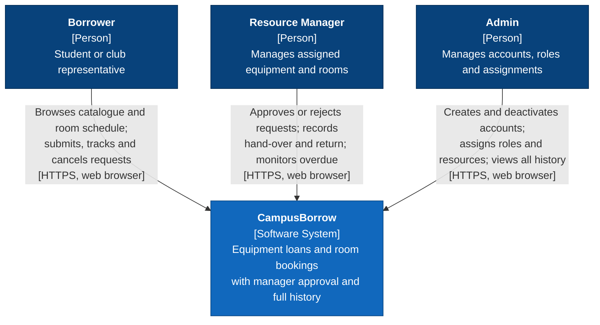

# 3 Proposed Solution

> PA1 draft — owner: Nguyen Tien Minh · reviewer: Phan Nhat Anh. Decision record: `docs/design/adr/ADR-001-tech-stack.md`.

## 3.1 Preliminary Architecture

C4 Level 1 — System Context. CampusBorrow is a single web system used by three internal roles. In the agreed scope it **does not integrate with any external software system**: e-mail/SMS notifications, SSO and the academic timetable are out of scope (PA0 §2.7). Hosting platforms (Vercel, Supabase, Cloudflare) are deployment infrastructure and appear in the PA3 container and deployment diagrams, not at context level.

The diagram renders in GitHub and Obsidian. For the PDF submission, export it as an image (e.g. mermaid.live → PNG).

## 3.2 Technology Stack

| Layer | Technology | Reason for choice |
| :---- | :---- | :---- |
| Front end | React + Vite, TypeScript | Component-based UI with a large ecosystem, and Vite builds fast. It is a static build, separate from the API, so front-end and back-end work can run in parallel. |
| Back end | NestJS (Node.js, TypeScript) | Modules, controllers, services and dependency injection give a clear layered structure that maps onto PA3 class and sequence diagrams. A global `RolesGuard` enforces server-side RBAC (F01). Jest and a testing module are built in. |
| Database | PostgreSQL on Supabase (database only), Prisma ORM | ACID transactions and row locks (`SELECT … FOR UPDATE`) support atomic approve-and-reserve (F03). An exclusion constraint (`btree_gist`) blocks overlapping approved room bookings inside the database (F07). Prisma gives typed queries and versioned migrations. |
| Hosting / deployment | Vercel (static client + NestJS on Vercel Functions); Cloudflare DNS/CDN | Git-based deployment with a preview environment for each pull request and production from `main`. The client rewrites `/api/*` to the API, so both are served from one origin and cookies stay first-party. Cloudflare provides the custom domain, TLS and CDN. |
| Testing & CI | Jest (unit + coverage), Supertest (API), Playwright (E2E), GitHub Actions | Covers the PA5 criteria: unit tests with a coverage report, ≥ 2 use cases × 2 scenarios automated end-to-end, and CI that runs lint, tests and build on every pull request. |

## 3.3 Hardware and Operating Environment

| Environment | Hardware / platform | Software |
| :---- | :---- | :---- |
| Development | Each member's laptop: Windows 10/11 or macOS, ≥ 8 GB RAM, internet connection | Node.js 24 LTS, npm, Git, VS Code, a modern browser. Database: a shared Supabase development project, or local PostgreSQL in Docker (optional) |
| Continuous integration | GitHub-hosted runner (`ubuntu-latest`) | Node.js 24 LTS; PostgreSQL service container for API and E2E tests; Playwright browsers |
| Preview / production | Vercel (Singapore region), Supabase PostgreSQL (Singapore region), Cloudflare DNS | NestJS on Vercel Functions; static React build on the Vercel CDN; connections through the Supabase pooler |
| End users | Desktop or mobile device with internet access | Latest two versions of Chrome, Edge, Firefox or Safari; responsive layout from 360 px width; no installation required |

Operating constraints:
- All timestamps are stored as `timestamptz` and shown in Vietnam time (UTC+7).
- Secrets live only in Vercel/GitHub environment settings, never in the repository.
- Free-tier quotas (Vercel, Supabase) are checked before the week 11 demo.
